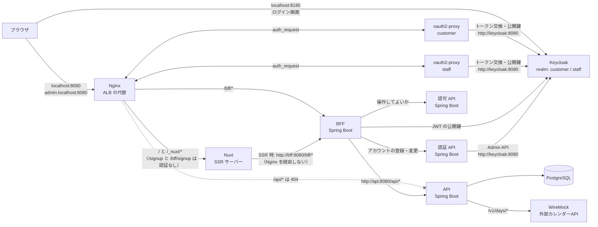
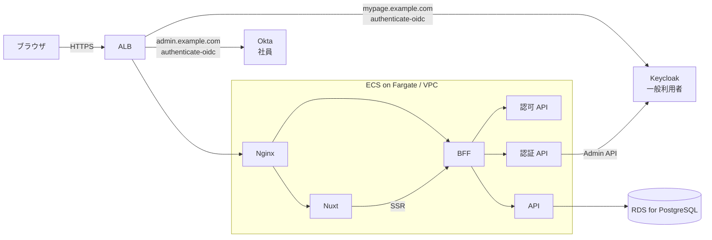
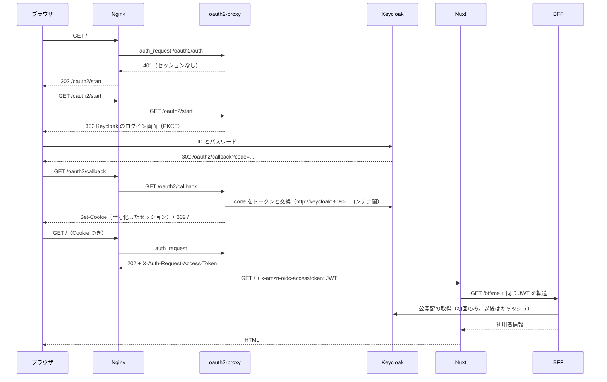
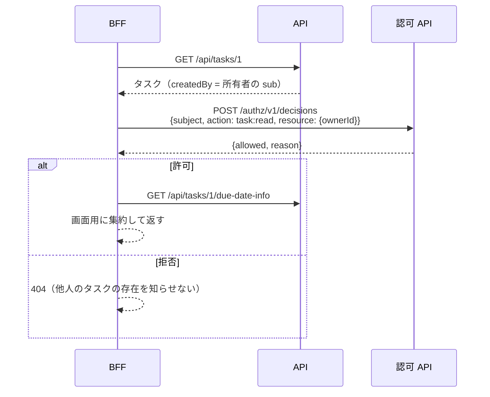

# アーキテクチャ

この文書は学習用の構成を説明するものです。機能ごとの設計は [design/](design/README.md)、決定の記録は [adr/](adr/) にあります。業務環境の事実を記したものではありません。業務環境について聞いている事実と、不確かなまま置いた仮定は「[仮定](#仮定)」で分けて示しています。

## ローカル環境の構成図

ホストに公開するポートは 2 つだけです。

| ポート | 用途 | 対応する AWS の構成 |
|---|---|---|
| Nginx の 8080 | アプリの入口 | ALB |
| Keycloak の 8180 | ログイン画面 | IdP（Keycloak や Okta）。アプリとは別のドメインにある |

BFF・認証 API・認可 API・API・DB・WireMock には、ホストから直接アクセスできません。

## AWS 環境の構成図（予定）

ALB は Host ヘッダーごとにリスナールールを分けます。一般利用者向けのホストは Keycloak、管理画面のホストは Okta の `authenticate-oidc` を使い、認証が済んだらどちらも同じ Nginx へ転送します。会員登録の公開パス（`/signup`、`/bff/signup`、`/_nuxt/*`）は、一般利用者向けのホストにだけ認証アクションなしのルールを作ります。Keycloak を AWS 上で自前運用するか、既存のものを使うかは未定です（[aws-roadmap.md](aws-roadmap.md#alb-の認証)）。

## 各サービスの役割

| サービス | 役割 | 持たないもの |
|---|---|---|
| **Nginx** | 入口です。ホストとパスで振り分け、`auth_request` で oauth2-proxy に認証を確認させ、ALB と同じ名前のヘッダーで JWT を後段へ渡します。`X-Request-Id` も採番します | 業務ロジック、トークンの検証 |
| **oauth2-proxy** | ALB の認証アクションの代わりです。IdP へのリダイレクト、コールバック処理、セッション Cookie、トークンの更新、ログアウトを担当します。ホスト（IdP）ごとに 1 つ動かします | 認可 |
| **Keycloak** | IdP です。realm `customer` は一般利用者用で、定義は認証 API のリポジトリ（`auth/keycloak/import/`）にあります。realm `staff` は Okta の代わりで、ロールを Okta と同じく `groups` クレームで出します | — |
| **Nuxt** | 画面の描画です。初回は SSR、その後は SPA として動きます。BFF の `/bff/me` の結果を見て、画面を出し分けます（登録ボタンの表示など） | 業務データ、認可の判断 |
| **BFF** | 画面専用の API です。**JWT を検証**し（署名、`iss`、`aud`、有効期限）、IdP ごとのクレームの違いを吸収します。操作の前に**認可 API に問い合わせ**、API の結果を画面の形に組み立てます | 永続化、認可ルールそのもの |
| **認可 API** | 「この主体は、この操作を、この対象に対してしてよいか」を判定します。社員はロールで判定し（RBAC）、一般利用者は所有者かどうかで判定します | 認証、業務データ |
| **認証 API** | 一般利用者のアカウント管理です。Keycloak の Admin API の前段として、会員登録（ユーザーの作成とロールの付与）、参照、パスワード変更を提供します。業務環境では独立したリポジトリでした（責務は[仮定 12](#仮定)） | ログイン（トークンの発行）、認可、社員のアカウント |
| **API** | 業務データの API です。入力の検証、永続化、外部サービスとの連携を担います。利用者 ID と名前は、BFF から `X-User-Id` と `X-User-Name` で受け取ります | 認証・認可の判断 |
| **PostgreSQL** | タスクの保存先です。スキーマは API が Flyway で管理します | — |
| **WireMock** | 外部カレンダーサービスの代わりです | — |

### Nuxt のサーバー機能と BFF の違い

Nuxt にもサーバー（Nitro）があり、`server/api/` に API を書けます。それでも別の BFF を立てるのは、責務とライフサイクルを分けたいからです。

- **Nuxt サーバー**は「HTML を作るための実行環境」です。このリポジトリでは SSR と `/healthz` だけに使い、データを取るときは BFF を呼びます。
- **BFF** は「画面向け API の境界」です。JWT の検証、認可の問い合わせ、複数の API の集約、エラーの変換を一箇所にまとめます。画面が Nuxt 以外（モバイルアプリなど）に増えても、BFF は同じ考え方で使えます。

## 認証と認可

### 用語と分担

| | 担当 | 判断に使うもの |
|---|---|---|
| 認証（本人であることの確認） | IdP（Keycloak / Okta） + 前段（ALB / oauth2-proxy） | ID とパスワードなど |
| トークンの検証 | BFF | JWT の署名（IdP の公開鍵）、`iss`、`aud`、`exp` |
| 認可（その操作をしてよいか） | 認可 API（BFF が問い合わせる） | 利用者の種別、ロール、対象の所有者 |
| 画面の出し分け | Nuxt | BFF が返す `capabilities`。表示を変えるだけで、守りは BFF と認可 API が担う |

### ログインの流れ

### 認可の流れ（タスク詳細の例）

| 操作 | 一般利用者 | 社員 `task-viewer` | 社員 `task-admin` |
|---|---|---|---|
| 一覧 | 自分のタスクだけ | 全件 | 全件 |
| 詳細 | 自分のタスクだけ（他人のものは 404） | 全件 | 全件 |
| 登録 | できる | できない（403） | できる |

方針は [authz の application.yml](../authz/src/main/resources/application.yml) と [Policy.kt](../authz/src/main/kotlin/com/example/fullstacklab/authz/Policy.kt) にあります。

### 設計上のポイント

- **ブラウザに見える URL とコンテナ間の URL を分けています。** トークンの `iss` とログイン画面は `http://localhost:8180`（ブラウザから見た URL）です。一方、トークン交換と公開鍵の取得は `http://keycloak:8080`（コンテナ間の URL）を使います。そのため、Keycloak は `KC_HOSTNAME_BACKCHANNEL_DYNAMIC` で両方を受け付け、oauth2-proxy は `skip_oidc_discovery` で URL を個別に指定し、BFF は `issuer-uri` と `jwk-set-uri` を別々に設定しています。
- **BFF は前段を信じ切らずに JWT を検証します。** Nginx（ALB）が偽のヘッダーを上書きするうえに、BFF が署名も確かめるので、二重の防御になります。スモークテストでは、コンテナ内から署名のない JWT を直接送り、401 になることを確認しています。
- **`aud` も検証します。** 同じ IdP が別のアプリ向けに発行したトークンを受け付けないためです。
- **一般利用者のセッションは管理画面では使えません。** ホストごとに Cookie と oauth2-proxy が分かれており、管理画面側では一般利用者の Cookie を認識しないので 401 になります。
- **認可 API が落ちたら拒否します（fail-closed）。** 外部カレンダーが落ちたときは縮退表示（fail-open）にしているのと対照的です。認可は「判定できない＝許可しない」が原則です。
- **API の未認証の 401 と、画面の未認証のリダイレクトを分けています。** `/bff/*` は 401 を返し、画面側で `/oauth2/start` に移動させます。fetch がログイン画面の HTML を受け取ってしまう事故を防ぐためです。
- **CSRF について。** セッション Cookie を持つのは前段のプロキシだけです（`SameSite=Lax`）。BFF は JSON しか受け付けないので、別サイトからのフォーム送信は成立しません。BFF 自身はセッションを持たないので、CSRF トークンは使っていません。

## 契約（OpenAPI）とリポジトリの分割

業務環境と同じく、領域ごとにリポジトリを分け、領域同士は OpenAPI の契約だけでつなぎます。画面と BFF は同じチームが扱うので 1 つのリポジトリ（`web`）にまとめ、API と認可 API はそれぞれ独立したリポジトリです。集約リポジトリ（`fullstack-lab`）が git submodule で 3 つを参照し、Compose とドキュメントを持ちます。

### 契約と生成物

| 契約 | 提供側（生成して git で管理） | 利用側 |
|---|---|---|
| `api/openapi/api.yaml` | `kotlin-spring` でコントローラーのインターフェースと DTO。`TaskController` が `TasksApi` を実装する | BFF が `api-client`（`kotlin` の `jvm-spring-restclient`、Jackson 3）を Maven 成果物として取得する |
| `authz/openapi/authz.yaml` | 同上。`DecisionController` が `DecisionsApi` を実装する | BFF が `authz-client` を取得する |
| `web/openapi/bff.yaml` | `kotlin-spring` で BFF のインターフェースと DTO。`BffController` が `MeApi` / `TasksApi` を実装する | 画面が `openapi-typescript` で型を生成し、`openapi-fetch` の型付きクライアントで呼ぶ |

生成コードは業務環境と同じく git で管理します。置き場所は Kotlin が各リポジトリの `src/generated`（クライアントは `client/src/generated`）、画面が `frontend/app/types/bff.d.ts` です。仕様を変えたら `scripts/generate.sh` で生成し直し、生成物も同じコミットに含めます。ビルドは生成し直さず、コミットされたコードをそのまま成果物にします。「仕様だけ直して生成し忘れる」「生成コードを手で直す」事故は、各リポジトリの Docker の `check-generated` ステージ（`test` / `typecheck` の前段）が生成し直して差分を取ることで防ぎます。理由と比較は [ADR-0003](adr/ADR-0003-commit-generated-code.md) にあります。

### 成果物の配布（CodeArtifact の代替）

BFF は API と認可 API の**ソースを参照しません**。それぞれのリポジトリが publish したクライアントに、バージョンを指定して依存します（`web/bff/gradle.properties`）。

| 環境 | Maven リポジトリ | 取得 | publish |
|---|---|---|---|
| ローカル | Reposilite（Compose 内、`localhost:8081`） | 匿名 | `scripts/publish-clients.sh`（トークンは `.env`） |
| CI（GitHub Actions） | GitHub Packages | `GITHUB_TOKEN` | `api` / `authz` の CI が main への取り込み時に実行 |
| AWS（予定） | CodeArtifact | IAM ロールで取得したトークン | CodeBuild |

どの環境でも、Gradle の設定は同じ環境変数（`MAVEN_REPO_URL`、`MAVEN_REPO_PUBLISH_URL`、`MAVEN_REPO_USER`、`MAVEN_REPO_PASSWORD`）で切り替わります。同じバージョンは上書きできません（CodeArtifact と同じ）。契約を変えたら `info.version` と `version` を上げます。ずれていると publish が失敗します。

### Nuxt と OpenAPI の相性について

業務環境では、画面側は型や DTO を OpenAPI から生成しつつ、BFF を呼ぶクライアントは自前で書いていたと聞いています。Nuxt と OpenAPI の相性自体は悪くありません。合わないのは、`typescript-axios` や `typescript-fetch` のように**HTTP の層まで丸ごと生成する**方式と Nuxt の SSR です。

- 生成コードが独自の HTTP 層（axios など）を持つと、Nuxt の `$fetch` / `useAsyncData` と二重になり、SSR 時の呼び先の切り替えやヘッダー（JWT、リクエスト ID）の転送を、生成コードの外側で包み直す必要が出ます
- クラス型のクライアント（`new TasksApi(config)`）は composable の書き方に合わず、SSR の結果をブラウザへ渡す仕組みとも噛み合いにくいです

このリポジトリでは「型だけを生成し、HTTP の層は fetch に任せる」方式にしています。`openapi-typescript` が `paths` と `components` の型を作り、`openapi-fetch`（薄い型付きラッパー）がそれを使います。`useBff()` の中身（SSR とブラウザの切り替え、ヘッダーの転送、401 時のログイン誘導）は手書きのまま残り、パス・パラメーター・レスポンスの型だけが契約から来ます。業務環境で自前で書いていたクライアントを、型安全にしたものに相当します。

### Swagger UI

3 つの仕様を 1 つの Swagger UI（`/swagger/`）で見られます。入口の Nginx の背後に置き、ログイン後にだけ開けます。BFF の仕様は `servers: /`（同一オリジン）なので、ログイン済みのセッションのまま「Try it out」が動きます。API と認可 API は入口から到達できないので、参照のみです。

### 設計上のポイント

- **生成コードを業務ロジックに広げない。** API では業務モデル（`Task`）と DTO を `TaskMapping` で変換し、BFF では api-client の DTO と画面向け DTO を `TaskViewService` の中で変換します。契約が変わったときの影響を境界に閉じ込めるためです
- **呼び出し側の RestClient は呼び出し側が組み立てる。** 生成クライアントは `RestClient` を受け取る形なので、接続先・タイムアウト・リクエスト ID の引き継ぎは BFF 側の `buildInternalRestClient` で一元管理できます
- **契約の後方互換。** 古いバージョンのクライアントは残るので、API と BFF を同時にデプロイする必要はありません。項目の追加は互換ですが、必須項目の追加や削除は非互換なので、メジャーバージョンを上げます

## リクエストの流れ（認証済みの場合）

### 1. 画面の取得（SSR）

ブラウザ → Nginx（`auth_request`）→ Nuxt → `http://bff:8080/bff/*` → 認可 API と API、の順に流れます。SSR の通信は Nginx を通らないので、Nginx が付けた `x-amzn-oidc-accesstoken` と `x-request-id` は、Nuxt が自分で BFF へ引き継ぎます（[useBff.ts](../frontend/app/composables/useBff.ts)）。

### 2. ブラウザからの API 呼び出し（登録など）

ブラウザ → Nginx `/bff/*`（`auth_request`）→ BFF → 認可 API → API → PostgreSQL、の順に流れます。同一オリジンなので、CORS の設定は要りません。

### 3. 会員登録（未認証の公開パス）

ブラウザ → Nginx `/signup`（認証なし）→ Nuxt（SSR。`/bff/me` は 401 なので「未認証」として描画）、ブラウザ → Nginx `/bff/signup`（認証なし）→ BFF → 認証 API → Keycloak の Admin API、の順に流れます。登録後は「ログインする」の導線から、いつものログインの流れに入ります。公開パスを通るリクエストは、Nginx が `X-Amzn-Oidc-*` を空にしてから転送します（[public-proxy.conf](../nginx/snippets/public-proxy.conf)）。

### パス設計のポイント

- BFF 自身が `/bff` を接頭辞に持ちます。ブラウザ経由でも SSR でもパスが同じになり、プロキシ側でパスを書き換える必要がありません。
- 一般利用者用と社員用で、同じ Nuxt と BFF を共有します。利用者の種別はホストではなく、BFF が JWT の発行元（`iss`）から判断します。
- 公開パスは一般利用者用のホストにだけあります。社員用のホストでは `/signup` も `auth_request` で守られます。

## 障害と起動順序への備え

- `depends_on` は `condition: service_healthy` にしています。各アプリは `restart: on-failure` です。
- Nginx は upstream の名前をリクエストのたびに解決します。そのため、転送先のコンテナを作り直しても Nginx の再起動は要りません。
- BFF と認証 API は Keycloak の起動を待たずに起動します。公開鍵とサービスアカウントのトークンは最初のリクエストのときに取得します。
- 外部カレンダーの障害は縮退して表示し、認可 API の障害は 503 で拒否します。認証 API の障害は会員登録とパスワード変更だけに影響し、ログインとタスクの操作は続けられます。
- アクセストークンの有効期限は 5 分です。oauth2-proxy は 4 分ごとに更新し、新しい Cookie を Nginx 経由でブラウザへ返します。

## 仮定

### 業務環境について聞いている事実

- 画面へのアクセスは ALB を経由し、認証を通過した後に Nuxt や BFF に届く。
- 社員は Okta、一般利用者（マイページ）は Keycloak で認証していた。
- トークンには JWT を使っていた。
- 認可 API があり、BFF が呼んでいた。
- 認証 API が独立したリポジトリにあり、その中に Keycloak があった（責務は不明）。
- 領域同士は OpenAPI でつないでいた。API を呼ぶときは API クライアントを作り、Swagger UI もあった。
- 画面と BFF は同じリポジトリ、API はそれぞれ独立したリポジトリだった。
- 画面と BFF の間も OpenAPI から TypeScript の型・DTO・コントローラーのインターフェースを生成していたが、画面が BFF を呼ぶクライアントは自前で書いていた。
- OpenAPI から生成したコードは git で管理していた。
- 設計書（Markdown）を先に書き、それに沿って AI（スキル・エージェント）で実装する進め方をしていた。
- テストは画面が Playwright、API が Karate だった。

### 学習用に置いた仮定

| # | 不明点 | 学習用の仮定 | 理由 |
|---|---|---|---|
| 1 | Nginx の位置 | ALB の背後に入口のプロキシとして置く | ローカルと AWS で同じ設定を使えるため |
| 2 | ALB と 2 つの IdP の関係 | ホスト（一般利用者用と社員用）ごとにリスナールールを分け、それぞれ `authenticate-oidc` を設定する | ALB の機能で素直に実現できる形。パスで分けている可能性もある |
| 3 | BFF が受け取る JWT | ALB が転送する IdP のアクセストークン（`x-amzn-oidc-accesstoken`）を BFF が検証する | 「JWT を使っていた」という事実に合う。ALB が署名する `x-amzn-oidc-data` を検証する方式や、両方を検証する方式もある |
| 4 | 認可 API の入出力 | 主体（ID、種別、ロール）、操作、対象（所有者）を渡し、許可か拒否かと理由を受け取る | 一般的な PDP（Policy Decision Point）の形 |
| 5 | 認可のルールの置き場所 | 社員のロール名は IdP（Okta のグループ）で管理し、ロールごとの権限は認可 API の設定で管理する | ロールの付与（人事・情シス）と権限の定義（アプリ）を分けるため。業務では DB で管理していた可能性がある |
| 6 | 一般利用者の認可 | ロールではなく、所有者かどうかで判定する | マイページは「自分のデータだけ」が基本のため |
| 7 | API の認可 | API は BFF を信頼し、自分では認可しない | 業務と同じく BFF が認可 API を呼ぶ構成に合わせた。API でも JWT を検証する多層防御は発展課題 |
| 8 | DB マイグレーション | API の起動時に Flyway で実行する | 構成を最小にするため |
| 9 | 外部サービス | 期限日が営業日か祝日かを返すカレンダー API | 「タスクの補足情報」の題材 |
| 10 | クライアントの配布方法 | API 側が生成したクライアントを Maven 成果物として publish し、BFF がバージョンで依存する | 「API クライアントを作っていた」「CodeArtifact を使っていた」という事実に合う形。業務では BFF 側で生成していた可能性もある |
| 11 | 画面側のクライアント | 型だけ生成し、呼び出しは `openapi-fetch` + 手書きの composable | 業務では自前のクライアント。ここでは型安全にした形を採る（上記「Nuxt と OpenAPI の相性」） |
| 12 | 認証 API の責務 | Keycloak のユーザー管理の代行（会員登録、参照、パスワード変更）。ログインは担当しない | 業務の責務は不明。前段（ALB）の認証と重ならない範囲に絞った（[設計書 0005](design/0005-auth-api-and-signup.md)） |
| 13 | 会員登録の経路 | 未認証の公開パス（`/signup`、`/bff/signup`）を入口が認証なしで転送する | ALB ではリスナールールごとに認証アクションの有無を選べるため |
| 14 | Keycloak の設定の置き場所 | realm `customer` は認証 API のリポジトリ、realm `staff`（Okta の代替）は集約リポジトリ | 「認証 API の中に Keycloak があった」という事実に合わせた。staff は業務環境に無い学習用の設定のため |
