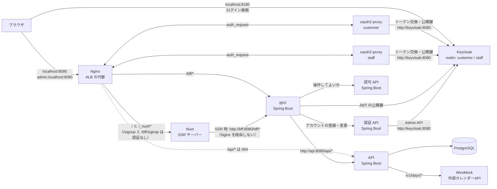
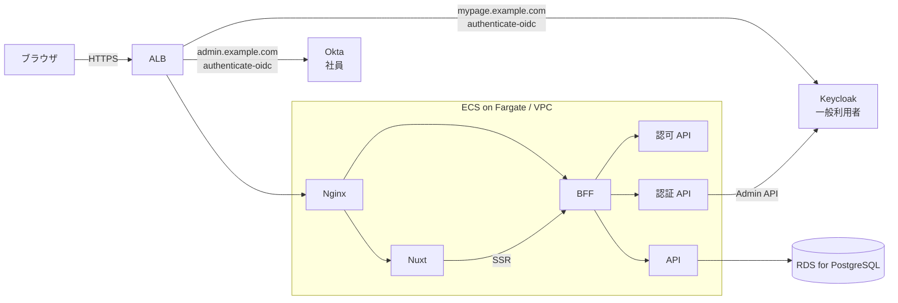
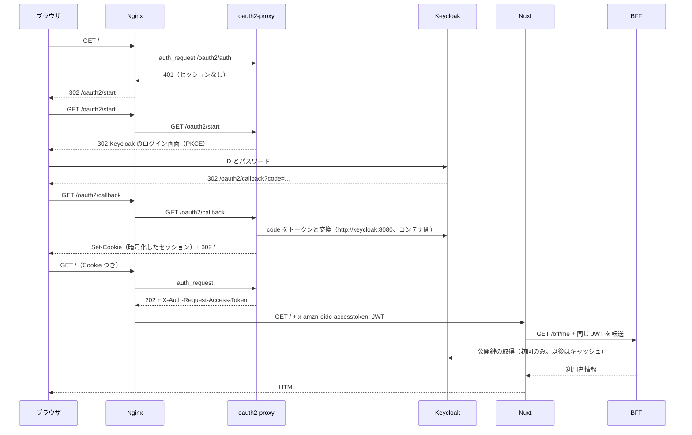
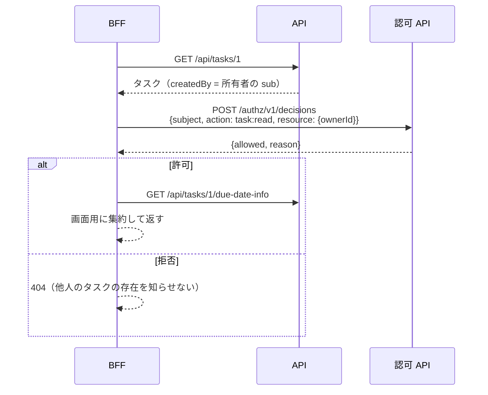

# アーキテクチャ

| 項目 | 内容 |
|---|---|
| 発信日 | 2026-10-30 |
| 作成者 | ht-0328（Claude Code で作成） |
| 機密区分 | 公開可 |
| 保守責任者 | ht-0328 |
| 最終確認日 | 2026-11-01 |
| 想定読者（宛先） | 構成を把握したい開発者（人と AI）、新しく参加する人 |
| この文書を読んだあと読者ができること | 各サービスの役割、認証・認可とリクエストの流れ、業務環境の事実と学習用の仮定の区別を説明できる |

この文書は、タスク管理アプリ fullstack-lab の今の構成を説明します。構成図、各サービスの役割、認証・認可とリクエストの流れ、契約（リポジトリ同士をつなぐ API の取り決め）とリポジトリの分け方、文書で使う[用語](#用語)、業務環境について聞いている事実と学習用に置いた仮定を載せています。このリポジトリは業務環境（作成者 ht-0328 が以前いた職場）の構成を学習用に再現したもので、業務環境の事実そのものを記したものではありません。業務環境について聞いている事実と、不確かなまま置いた仮定は「[仮定](#仮定)」で分けて示します。

機能ごとの設計は [design/](../design/README.md)、決定の記録は [adr/](../adr/README.md)、計画は [roadmap/](../roadmap/README.md)、文書の種類、置き場所、書き方は [docs（文書の置き場所と書き方）](../README.md) にあります。

## ローカル環境の構成図

次の図は、`docker compose` で起動したときのコンテナと、その間の通信を示します。矢印のラベルは、宛先の URL やパス、または通信の目的です。

次の表は、ホストに公開するポートと、AWS で対応する構成を示します。アプリの実行中にブラウザが使うのは Nginx と Keycloak の 2 つです。Reposilite（ライブラリを置く Maven リポジトリ）は、API・認可 API・認証 API の契約から生成したクライアントのライブラリを publish（Maven リポジトリに登録すること。[用語](#用語)）するときと、BFF のビルドでそれを取得するときだけ使います。

| ポート | 用途 | 対応する AWS の構成 |
|---|---|---|
| Nginx の 8080 | アプリの入口（[用語](#用語)） | ALB（AWS の Application Load Balancer） |
| Keycloak の 8180 | ログイン画面 | IdP（[用語](#用語)。Keycloak や Okta）。アプリとは別のドメインにある |
| Reposilite の 8081 | Maven リポジトリ。クライアントの取得と publish（「[成果物の配布（CodeArtifact の代替）](#成果物の配布codeartifact-の代替)」） | CodeArtifact（AWS の成果物リポジトリ） |

BFF（Backend for Frontend。画面専用の API。[用語](#用語)）・認証 API・認可 API・API・PostgreSQL・WireMock には、ホストから直接アクセスできません。

## AWS 環境の構成図（予定）

次の図は、同じ構成を AWS に置くときの予定を示します。ローカルで oauth2-proxy（ログインとセッションを担う前段。[用語](#用語)）がしていることは、AWS では ALB の認証アクション（ALB が転送の前に IdP でログインさせる機能）が担います。Nginx は ALB の背後に残ります（[仮定 1](#仮定)）。

ALB は Host ヘッダーごとにリスナールール（転送先と認証の有無を決める規則）を分けます（[仮定 2](#仮定)）。一般利用者向けのホストは Keycloak、管理画面のホストは Okta を、認証アクション `authenticate-oidc` で使います。認証が済んだら、どちらも同じ Nginx へ転送します。会員登録の公開パス（`/signup`、`/bff/signup`、`/_nuxt/*`）は、一般利用者向けのホストにだけ認証アクションなしのルールを作ります（[仮定 13](#仮定)）。

AWS 上の Keycloak は ECS（AWS のコンテナ実行サービス）で自前運用すると、2026-11-01 に作成者が決めました（[ロードマップの「ALB の認証」](../roadmap/README.md#alb-の認証)）。

## 各サービスの役割

次の表は、ローカル環境を構成するサービスごとに、担う役割と、あえて持たせていないものを示します。「持たないもの」は、責務の境界を間違えやすい点です。

| サービス | 役割 | 持たないもの |
|---|---|---|
| **Nginx** | 入口です。ホストとパスで振り分け、`auth_request` で oauth2-proxy に認証を確認させ、ALB と同じ名前のヘッダー（`x-amzn-oidc-accesstoken`）で JWT（IdP が署名して発行するトークン。[用語](#用語)）を後段へ渡します。リクエストを追うための `x-request-id` も採番します | 業務ロジック、トークンの検証 |
| **oauth2-proxy** | 前段（[用語](#用語)）です。ALB の認証アクションの代わりに、IdP へのリダイレクト、コールバック処理、セッション Cookie、トークンの更新、ログアウトを担当します。ホスト（IdP）ごとに 1 つ動かします | 認可 |
| **Keycloak** | IdP です。realm（Keycloak の中で利用者とクライアントをまとめる単位）`customer` は一般利用者用で、定義は認証 API のリポジトリ（`auth/keycloak/import/`）にあります。realm `staff` は Okta の代わりで、ロールを Okta と同じく `groups` クレーム（トークンに含まれる項目）で出します（[仮定 5](#仮定)） | — |
| **Nuxt** | 画面の描画です。初回は SSR（サーバーで HTML を作って返す）、その後は SPA（ブラウザ側で画面を切り替える）として動きます。BFF の `/bff/me` の結果を見て、画面を出し分けます（登録ボタンの表示など） | 業務データ、認可の判断 |
| **BFF** | 画面専用の API です。**JWT を検証**し（署名、発行元 `iss`、宛先 `aud`、有効期限 `exp`）、IdP ごとのクレームの違いを吸収します。操作の前に**認可 API に問い合わせ**、API の結果を画面の形に組み立てます | 永続化、認可ルールそのもの |
| **認可 API** | 「この主体は、この操作を、この対象に対してしてよいか」を判定します。社員はロールで判定し（RBAC。ロールに権限を結び付ける方式）、一般利用者は所有者かどうかで判定します | 認証、業務データ |
| **認証 API** | 一般利用者のアカウント管理です。Keycloak の Admin API を代わりに呼ぶ窓口として、会員登録（ユーザーの作成とロールの付与）、参照、パスワード変更を提供します。業務環境では独立したリポジトリでした（責務は[仮定 12](#仮定)） | ログイン（トークンの発行）、認可、社員のアカウント |
| **API** | 業務データの API です。入力の検証、永続化、外部サービスとの連携を担います。利用者 ID と名前は、BFF から `X-User-Id` と `X-User-Name` で受け取ります | 認証・認可の判断 |
| **PostgreSQL** | タスクの保存先です。スキーマは API が Flyway（DB マイグレーションのツール）で管理します | — |
| **WireMock** | 外部サービス（期限日が営業日か祝日かを返すカレンダー API。[仮定 9](#仮定)）の代わりです | — |

### Nuxt のサーバー機能と BFF の違い

Nuxt にもサーバー（Nitro。Nuxt のサーバーエンジン）があり、`server/api/` に API を書けます。それでも別の BFF を立てるのは、責務とライフサイクルを分けたいからです。

- **Nuxt サーバー**は「HTML を作るための実行環境」です。このリポジトリでは SSR と `/healthz` だけに使い、データを取るときは BFF を呼びます。
- **BFF** は「画面向け API の境界」です。JWT の検証、認可の問い合わせ、複数の API の集約、エラーの変換を一箇所にまとめます。画面が Nuxt 以外（モバイルアプリなど）に増えても、BFF は同じ考え方で使えます。

## 認証と認可

### 認証と認可の分担

次の表は、認証・認可に関わる 4 つの役割を、どのサービスが担い、何を根拠に判断するかで分けて示します。「認証」と「認可」を別のサービスが担うのが、この構成の要点です。

| 役割 | 担当 | 判断に使うもの |
|---|---|---|
| 認証（本人であることの確認） | IdP（Keycloak / Okta）と前段（oauth2-proxy / ALB の認証アクション） | ID とパスワードなど |
| トークンの検証 | BFF | JWT の署名（IdP の公開鍵）、発行元 `iss`、宛先 `aud`、有効期限 `exp` |
| 認可（その操作をしてよいか） | 認可 API（BFF が問い合わせる） | 利用者の種別、ロール、対象の所有者 |
| 画面の出し分け | Nuxt | BFF が返す `capabilities`（`canCreateTask` など、操作ごとの可否の一覧）。表示を変えるだけで、守りは BFF と認可 API が担う |

### ログインの流れ

次の図は、未ログインのブラウザが `/` を開いてから HTML を受け取るまでを示します。ブラウザが Keycloak と直接やり取りするのはログイン画面だけで、トークンの交換と保管は oauth2-proxy が行い、ブラウザには暗号化した Cookie だけが渡ります。

### 認可の流れ（タスク詳細の例）

次の図は、タスク詳細を開くときに BFF が API と認可 API を呼ぶ順を示します。BFF は先にタスクを取って所有者を知り、それを添えて認可 API に問い合わせ、拒否なら 404 を返します（他人のタスクがあることを知らせないため）。

### 操作ごとの権限

次の表は、タスクの操作ごとに、誰が何をできるかを示します。一般利用者は自分のタスクかどうかで、社員は IdP のグループに対応するロール `task-viewer`（閲覧のみ）と `task-admin`（閲覧、登録、完了）で決まります。

| 操作 | 一般利用者 | 社員 `task-viewer` | 社員 `task-admin` |
|---|---|---|---|
| 一覧 | 自分のタスクだけ | 全件 | 全件 |
| 詳細 | 自分のタスクだけ（他人のものは 404） | 全件 | 全件 |
| 登録 | できる | できない（403） | できる |
| 完了 | 自分のタスクだけ | できない（403） | できる（他人のタスクも） |

パスワード変更（操作 `account:change-password`）は、一般利用者が自分のアカウントにだけできます。社員のアカウントは Okta 側で管理するので、どのロールにも付けていません。ロールごとに許す操作の一覧は [authz の application.yml](../../authz/src/main/resources/application.yml) に、判定の手順は [Policy.kt](../../authz/src/main/kotlin/com/example/fullstacklab/authz/Policy.kt) にあります。

### 認証・認可の設計上のポイント

構成図を見ただけでは分からない、認証・認可の判断を挙げます。

- **ブラウザに見える URL とコンテナ間の URL を分けています。** トークンの `iss` とログイン画面は `http://localhost:8180`（ブラウザから見た URL）、トークン交換と公開鍵の取得は `http://keycloak:8080`（コンテナ間の URL）を使います。ブラウザからはコンテナ名 `keycloak` を解決できず、コンテナからは `localhost` が自分自身を指すため、同じ Keycloak を 2 つの URL で呼び分ける必要があります。そのため、次の 3 か所で両方の URL を扱います。
  - Keycloak は `KC_HOSTNAME_BACKCHANNEL_DYNAMIC` で両方の URL を受け付けます。
  - oauth2-proxy は `skip_oidc_discovery` で URL を個別に指定します。
  - BFF は `issuer-uri` と `jwk-set-uri` を別々に設定します。
- **BFF は入口と前段を信じ切らずに JWT を検証します。** 入口の Nginx（AWS では ALB）がクライアントの付けてきた `x-amzn-oidc-*` ヘッダーを上書きするうえに、BFF が署名も確かめるので、二重の防御になります。スモークテスト（`scripts/smoke-test.sh`）では、コンテナ内から署名のない JWT を直接送り、401 になることを確認しています。
- **`aud` も検証します。** 同じ IdP が別のアプリ向けに発行したトークンを受け付けないためです。
- **一般利用者のセッションは管理画面では使えません。** ホストごとに Cookie と oauth2-proxy が分かれており、管理画面側では一般利用者の Cookie を認識しないので 401 になります。
- **認可 API が落ちたら拒否します（fail-closed。[用語](#用語)）。** 外部サービス（カレンダー API）が落ちたときは縮退（[用語](#用語)）させているのと対照的です。認可は「判定できない＝許可しない」が原則です。
- **BFF への呼び出しの未認証は 401、画面の取得の未認証はリダイレクトと分けています。** `/bff/*` は 401 を返し、画面側で `/oauth2/start` に移動させます。fetch がログイン画面の HTML を受け取ってしまう事故を防ぐためです。
- **CSRF（他サイトからの偽の送信）への対策は、Cookie の持ち方と受け付ける形式で足りると判断しています。** セッション Cookie（`SameSite=Lax`）を持つのは前段の oauth2-proxy だけで、BFF 自身はセッションを持たないので、CSRF トークンは使っていません。BFF は JSON しか受け付けないので、別サイトからのフォーム送信は成立しません。
- **アクセストークンの有効期限は 5 分です**（`auth/keycloak/import/customer-realm.json` と `keycloak/import/staff-realm.json` の `accessTokenLifespan`）。期限が切れる前に更新するため、oauth2-proxy は 4 分ごとに更新し（`compose.yaml` の `OAUTH2_PROXY_COOKIE_REFRESH`）、新しい Cookie を Nginx 経由でブラウザへ返します。

## 契約（OpenAPI）とリポジトリの分割

業務環境と同じく、領域（独立したリポジトリで作る単位。[用語](#用語)）ごとにリポジトリを分け、領域同士は OpenAPI の契約（[用語](#用語)）だけでつなぎます。画面と BFF も業務環境と同じく 1 つのリポジトリ（`web`）にまとめ、API（`api`）、認可 API（`authz`）、認証 API（`auth`）はそれぞれ独立したリポジトリです。集約リポジトリ（このリポジトリ `fullstack-lab`）が git submodule でこの 4 つと人が読む図解のリポジトリ（`references/architecture-notes`）を参照し、Compose とドキュメントを持ちます。

### 契約と生成物

次の表は、契約ごとに、提供側（[用語](#用語)）が何を生成して git で管理し、利用側がそれをどう使うかを示します。提供側はサーバーのインターフェースを、利用側はクライアントを契約から得ます。

| 契約 | 提供側（生成して git で管理） | 利用側 |
|---|---|---|
| `api/openapi/api.yaml` | `kotlin-spring` でコントローラーのインターフェースと DTO（やり取りするデータの型）。`TaskController` が `TasksApi` を実装する | BFF が、OpenAPI Generator の `kotlin`（library は `jvm-spring-restclient`、Jackson 3）で生成したクライアント `api-client` を Maven 成果物として取得する |
| `authz/openapi/authz.yaml` | 同上。`DecisionController` が `DecisionsApi` を実装する | BFF が `authz-client` を取得する |
| `auth/openapi/auth.yaml` | 同上。`CustomerController` が `CustomersApi` を実装する | BFF が `auth-client` を取得する |
| `web/openapi/bff.yaml` | `kotlin-spring` で BFF のインターフェースと DTO。`BffController` が `MeApi` / `TasksApi` を、`SignupController` が `SignupApi`（会員登録）を実装する | 画面が `openapi-typescript` で型を生成し、`openapi-fetch` の型付きクライアントで呼ぶ |

生成コードは業務環境と同じく git で管理します。置き場所は Kotlin が各リポジトリの `src/generated`（クライアントは `client/src/generated`）、画面が `frontend/app/types/bff.d.ts` です。仕様を変えたら `scripts/generate.sh` で生成し直し、生成物も同じコミットに含めます。

ビルドは生成し直さず、コミットされた生成コードをそのままビルドに使います。「仕様だけ直して生成し忘れる」「生成コードを手で直す」事故は、各リポジトリの Docker の `check-generated` ステージ（`test` / `typecheck` の前に走るステージ）が生成し直して差分を取ることで防ぎます。理由と比較は [ADR-0003](../adr/ADR-0003-commit-generated-code.md) にあります。

### 成果物の配布（CodeArtifact の代替）

CodeArtifact は AWS の成果物リポジトリ（ライブラリを登録して配布するサービス）で、ローカルと CI では別のものが同じ役割を担います。BFF は API・認可 API・認証 API の**ソースを参照しません**。それぞれのリポジトリが publish（[用語](#用語)）したクライアントに、バージョンを指定して依存します（`web/bff/gradle.properties`）。

次の表は、環境ごとに、クライアントを置く Maven リポジトリと、取得と publish の方法を示します。

| 環境 | Maven リポジトリ | 取得 | publish |
|---|---|---|---|
| ローカル | Reposilite（Compose 内、`localhost:8081`） | 匿名で取得できる | `scripts/publish-clients.sh` で publish する（トークンは `.env`） |
| CI（GitHub Actions） | GitHub Packages（GitHub の成果物リポジトリ） | `GITHUB_TOKEN` で取得する | `api` / `authz` / `auth` の CI が main への取り込み時に publish する |
| AWS（予定） | CodeArtifact | IAM ロール（AWS で権限をまとめて付ける単位）で得たトークンで取得する | CodeBuild（AWS のビルドサービス）が publish する |

どの環境でも、Gradle の設定は同じ環境変数（`MAVEN_REPO_URL`、`MAVEN_REPO_PUBLISH_URL`、`MAVEN_REPO_USER`、`MAVEN_REPO_PASSWORD`）で切り替わります。同じバージョンは上書きできません（CodeArtifact と同じ）。契約を変えたら、仕様の `info.version` とクライアントのビルドの `version`（各リポジトリの `gradle.properties`）を同じ値に上げます。2 つがずれていると publish が失敗します。

### 画面側のクライアントは型だけ生成する

この節は、画面（Nuxt）が BFF を呼ぶコードを、契約からどこまで生成するかの判断を説明します。業務環境では、画面側は型と DTO を OpenAPI から生成しつつ、BFF を呼ぶクライアントは自前で書いていたと作成者は聞いていますが、手で書いていた理由は分かっていません。そこで作成者が、Nuxt では生成したクライアントが使いにくいのかを確かめたところ、Nuxt と OpenAPI を組み合わせること自体に問題は無く、合わないのは `typescript-axios` や `typescript-fetch` のように**HTTP の層まで丸ごと生成する**方式と Nuxt の SSR でした。理由は次の 2 つです。

- 生成コードが独自の HTTP 層（axios など）を持つと、Nuxt のデータ取得の関数（`$fetch` / `useAsyncData`）と二重になります。SSR 時の呼び先の切り替えやヘッダー（JWT、リクエスト ID）の転送を、生成コードの外側で包み直す必要が出ます。
- クラス型のクライアント（生成された `TasksApi` クラスのインスタンスを作って使う形）は、composable（Vue で状態と処理を再利用する関数）の書き方に合いません。SSR の結果をブラウザへ渡す仕組み（サーバーで取得したデータを HTML と一緒に渡し、ブラウザで取り直さない仕組み）とも噛み合いにくいです。

このリポジトリでは「型だけを生成し、HTTP の層は fetch に任せる」方式にしています（[仮定 11](#仮定)）。`openapi-typescript` が `paths` と `components` の型を作り、`openapi-fetch`（薄い型付きラッパー）がそれを使います。`useBff()` の中身（SSR とブラウザの切り替え、ヘッダーの転送、401 時のログイン誘導）は手書きのまま残り、パス・パラメーター・レスポンスの型だけが契約から来ます。業務環境で自前で書いていたクライアントを、型安全にしたものに相当します。

理由と比較は [ADR-0001](../adr/ADR-0001-nuxt-generates-types-only.md) にあります。

### Swagger UI

4 つの仕様を 1 つの Swagger UI（OpenAPI の仕様をブラウザで読み、試せる画面。`/swagger/`）で見られます。Swagger UI は入口の Nginx の背後にあり、`auth_request` で守っているので、ログイン後にだけ開けます。BFF の仕様は `servers: /`（同一オリジン）なので、ログイン済みのセッションのまま「Try it out」が動きます。API、認可 API、認証 API は入口から到達できないので、参照のみです。

### 契約の設計上のポイント

契約まわりで守っている判断を挙げます。

- **生成コードを業務ロジックに広げない。** API では業務モデル（`Task`）と DTO を `TaskMapping` で変換し、BFF では api-client の DTO と画面向け DTO を `TaskViewService` の中で変換します。契約が変わったときの影響を境界に閉じ込めるためです
- **呼び出し側の RestClient は呼び出し側が組み立てる。** 生成クライアントは `RestClient` を受け取る形なので、接続先・タイムアウト・リクエスト ID の引き継ぎは BFF 側の `buildInternalRestClient` で一元管理できます
- **契約は後方互換を保ち、非互換の変更はメジャーバージョンを上げる。** 古いバージョンのクライアントは残るので、API と BFF を同時にデプロイする必要はありません。項目の追加は互換ですが、必須項目の追加や削除は非互換です

## リクエストの流れ（3 つの経路）

ブラウザからのリクエストは、次の 3 つの経路のどれかを通ります。1 と 2 は認証済み、3 は未認証の公開パスです。

### 1. 画面の取得（SSR）

ブラウザ → Nginx（`auth_request`）→ Nuxt → `http://bff:8080/bff/*` → 認可 API と API、の順に流れます。SSR の通信は Nginx を通らないので、Nginx が付けた `x-amzn-oidc-accesstoken` と `x-request-id` は、Nuxt が自分で BFF へ引き継ぎます（[useBff.ts](../../web/frontend/app/composables/useBff.ts)）。

### 2. ブラウザからの BFF 呼び出し（タスクの登録など）

ブラウザ → Nginx `/bff/*`（`auth_request`）→ BFF → 認可 API → API → PostgreSQL、の順に流れます。同一オリジンなので、CORS（別オリジンへの fetch をブラウザが制限する仕組み）の設定は要りません。

### 3. 会員登録（未認証の公開パス）

画面は、ブラウザ → Nginx `/signup`（認証なし）→ Nuxt の順に流れます。画面の静的アセット（`/_nuxt/*`）も、Nginx が認証なしで Nuxt へ転送します。Nuxt は SSR で `/bff/me` を呼びますが 401 が返るので、「未認証」として描画します。登録の送信は、ブラウザ → Nginx `/bff/signup`（認証なし）→ BFF → 認証 API → Keycloak の Admin API の順に流れます。登録後は「ログインする」の導線から、いつものログインの流れに入ります。

公開パスを通るリクエストは認証していないので、Nginx はクライアントが付けてきた `x-amzn-oidc-*` を空にしてから転送します（[public-proxy.conf](../../nginx/snippets/public-proxy.conf)）。

### パス設計のポイント

URL の設計で守っている判断を挙げます。

- BFF 自身が `/bff` を接頭辞に持ちます。ブラウザ経由でも SSR でもパスが同じになり、プロキシ側でパスを書き換える必要がありません。
- 一般利用者用と社員用で、同じ Nuxt と BFF を共有します。利用者の種別はホストではなく、BFF が JWT の発行元（`iss`）から判断します。
- 公開パスは一般利用者用のホストにだけあります。社員用のホストでは `/signup` も `auth_request` で守られます。

## 障害と起動順序への備え

コンテナが落ちたときと起動の順序について、Compose と各サービスで備えていることを挙げます。

- Compose の `depends_on` は `condition: service_healthy` にしています。依存先が「起動した」ではなく「ヘルスチェックに応答できる」まで待つので、起動順序を手で揃える必要がありません。各アプリは `restart: on-failure` で、依存先が後から落ちて復帰したときも自動で再起動します。
- Nginx は upstream の名前をリクエストのたびに解決します。そのため、転送先のコンテナを作り直しても Nginx の再起動は要りません。
- BFF と認証 API は Keycloak の起動を待たずに起動します。BFF は公開鍵を、認証 API はサービスアカウント（利用者を介さずに Admin API を呼ぶための、認証 API 自身のアカウント）のトークンを、最初のリクエストのときに取得します。
- 外部サービス（カレンダー API）の障害は縮退して表示し、認可 API の障害は 503 で拒否します。認証 API の障害は会員登録とパスワード変更だけに影響し、ログインとタスクの操作は続けられます。

## 用語

次の表は、この文書と設計書、ADR、ロードマップで使う言葉の意味を示します。他の文書は、これらの語を最初に使うところでこの表にリンクするか、一言そえます（[docs の書き方 W-2](../README.md#書き方人が読める文書にする決まり)）。

| 言葉 | 意味 |
|---|---|
| 業務環境 | 作成者（ht-0328）が以前いた職場の構成。このリポジトリはそれを学習用に再現している。分かっている事実は「[仮定](#仮定)」の節の「業務環境について聞いている事実」にある |
| 集約リポジトリ | このリポジトリ fullstack-lab。4 つの領域のリポジトリと、人が読む図解のリポジトリ（`references/architecture-notes`）を git submodule で参照し、Compose、Nginx、ドキュメント、スクリプトを持つ |
| 領域 | 独立したリポジトリで作る単位。画面 + BFF（`web`）、API（`api`）、認可 API（`authz`）、認証 API（`auth`）の 4 つ |
| 契約 | 領域同士の API の取り決め。各領域の `openapi/*.yaml`。本文では「仕様」とも呼ぶ。領域はソースを共有せず、契約と、契約から生成して配布した成果物だけでつながる |
| 提供側 / 利用側 | 契約を定義して公開する側（API、認可 API、認証 API。画面に対しては BFF）と、それを呼ぶ側（BFF、画面） |
| 成果物、publish | 成果物は、提供側が契約から生成したクライアントのライブラリ（`api-client` など）で、利用側はバージョンを指定して取得する。publish は、成果物を Maven リポジトリに登録すること |
| 入口 | すべてのリクエストを最初に受けて振り分けるもの。ローカルは Nginx、AWS では ALB |
| 前段 | アプリより手前で認証とセッションを担う層。ローカルは oauth2-proxy、AWS では ALB の認証アクション |
| IdP | Identity Provider。ログインを受け付けてトークンを発行するサービス。一般利用者は Keycloak、社員は Okta（ローカルでは Keycloak の realm `staff` が代わり） |
| JWT | IdP が署名して発行するトークン。利用者の ID やロールを含み、BFF が署名と発行元 `iss`、宛先 `aud`、有効期限 `exp` を検証する |
| BFF | Backend for Frontend。画面専用のサーバー側 API。JWT を検証し、認可 API に問い合わせ、API を呼んで画面向けの形に組み立てる |
| 認可 API | 「この主体が、この操作を、この対象に行ってよいか」を判定して返す API。社員はロール、一般利用者は所有者かどうかで決める |
| 認証 API | 一般利用者のアカウント管理（会員登録、参照、パスワード変更）を Keycloak の Admin API を使って行う API。ログインは担当しない |
| SSR / SPA | SSR はサーバー側で HTML を作って返す描画、SPA はブラウザ側で画面を切り替える描画。Nuxt は初回が SSR、以後は SPA |
| 冪等 | 同じ操作を何回行っても結果が変わらないこと |
| fail-closed / 縮退 | fail-closed は、判定できないときは拒否すること（認可 API の失敗）。縮退は、外部サービスが落ちても主要な情報だけ返して動き続けること |
| 利用者 | アプリを使う人。一般利用者（マイページ）と社員（管理画面）の 2 種類 |
| 作成者 | 文書を書き、未決事項を決める人（ht-0328）。AI が文書を書くときは、AI に指示した人 |
| バージョン | 契約と成果物の版の番号（`info.version`、`gradle.properties` の `version`）。本文では「版」と書かず「バージョン」と書く |
| 展開（デプロイ） | 変更を環境に反映すること。本文では「デプロイ」、設計書の節名では「展開」と書く |
| スキル / エージェント | AI コーディングエージェント向けの手順書と、評価だけを返すサブエージェント。一覧は [AGENTS.md](../../AGENTS.md) の表 |

## 仮定

この節には、業務環境について聞いている事実と、分からない点を補うために学習用に置いた仮定を、対にして載せます。

### 業務環境について聞いている事実

次の箇条書きは、作成者が業務環境について聞いている事実です。この文書と設計書の判断は、これらの事実と、「学習用に置いた仮定」の表を根拠にします。

- 画面へのアクセスは ALB を経由し、認証を通過した後に Nuxt や BFF に届く。
- 社員は Okta、一般利用者（マイページ）は Keycloak で認証していた。
- トークンには JWT を使っていた。
- 認可 API があり、BFF が呼んでいた。
- 認証 API が独立したリポジトリにあり、その中に Keycloak があった（責務は不明）。
- 領域同士は OpenAPI でつないでいた。API を呼ぶときは API クライアントを作り、Swagger UI もあった。
- CodeArtifact を使っていた（用途の詳細は不明）。
- 画面と BFF は同じリポジトリ、API はそれぞれ独立したリポジトリだった。
- 画面と BFF の間も OpenAPI から TypeScript の型・DTO・コントローラーのインターフェースを生成していたが、画面が BFF を呼ぶクライアントは自前で書いていた。
- OpenAPI から生成したコードは git で管理していた。
- 設計書（Markdown）を先に書き、それに沿って AI（スキル・エージェント）で実装する進め方をしていた。
- テストは画面が Playwright、API が Karate だった。

### 学習用に置いた仮定

次の表は、業務環境について分からなかった点ごとに、このリポジトリで置いた仮定とその理由を示します。番号は、他の文書から「仮定 N」として参照します。

| # | 不明点 | 学習用の仮定 | 理由 |
|---|---|---|---|
| 1 | Nginx の位置 | ALB の背後に入口のプロキシとして置く | ローカルと AWS で同じ設定を使えるからです。 |
| 2 | ALB と 2 つの IdP の関係 | ホスト（一般利用者用と社員用）ごとにリスナールールを分け、それぞれ `authenticate-oidc` を設定する | ALB の機能で素直に実現できる形だからです。パスで分けている可能性もあります。 |
| 3 | BFF が受け取る JWT | ALB が転送する IdP のアクセストークン（`x-amzn-oidc-accesstoken`）を BFF が検証する | 「JWT を使っていた」という事実に合うからです。ALB が署名する `x-amzn-oidc-data` を検証する方式や、両方を検証する方式もあります。 |
| 4 | 認可 API の入出力 | 主体（ID、種別、ロール）、操作、対象（所有者）を渡し、許可か拒否かと理由を受け取る | 一般的な PDP（Policy Decision Point）の形だからです。 |
| 5 | 認可のルールの置き場所 | 社員のロール名は IdP（Okta のグループ）で管理し、ロールごとの権限は認可 API の設定で管理する | ロールの付与（人事・情シス）と権限の定義（アプリ）を分けるためです。業務環境では DB で管理していた可能性があります。 |
| 6 | 一般利用者の認可 | ロールではなく、所有者かどうかで判定する | マイページは「自分のデータだけ」が基本だからです。 |
| 7 | API の認可 | API は BFF を信頼し、自分では認可しない | 業務環境と同じく BFF が認可 API を呼ぶ構成に合わせました。API でも JWT を検証する多層防御は発展課題です。 |
| 8 | DB マイグレーション | API の起動時に Flyway で実行する | 構成を最小にするためです。 |
| 9 | 外部サービス | 期限日が営業日か祝日かを返すカレンダー API | 「タスクの補足情報」の題材にするためです。 |
| 10 | クライアントの配布方法 | API 側が生成したクライアントを Maven 成果物として publish し、BFF がバージョンで依存する | 「API クライアントを作っていた」「CodeArtifact を使っていた」という事実に合う形だからです。業務環境では BFF 側で生成していた可能性もあります。 |
| 11 | 画面側のクライアント | 型だけ生成し、呼び出しは `openapi-fetch` + 手書きの composable | 業務環境のクライアントは自前でした。ここでは、それを型安全にした形を採ります（「[画面側のクライアントは型だけ生成する](#画面側のクライアントは型だけ生成する)」）。 |
| 12 | 認証 API の責務 | Keycloak のユーザー管理の代行（会員登録、参照、パスワード変更）。ログインは担当しない | 業務環境での責務は不明です。前段（ALB の認証アクション）が担うログインと重ならない範囲に絞りました（[設計書 0005](../design/0005-auth-api-and-signup.md)）。 |
| 13 | 会員登録の経路 | 未認証の公開パス（`/signup`、`/bff/signup`、画面の静的アセットの `/_nuxt/*`）を入口が認証なしで転送する | ALB ではリスナールールごとに認証アクションの有無を選べるからです。 |
| 14 | Keycloak の設定の置き場所 | realm `customer` は認証 API のリポジトリ、realm `staff`（Okta の代替）は集約リポジトリ | realm `customer` は、「認証 API の中に Keycloak があった」という事実に合わせました。realm `staff` は業務環境に無い学習用の設定なので、集約リポジトリに置きました。 |
