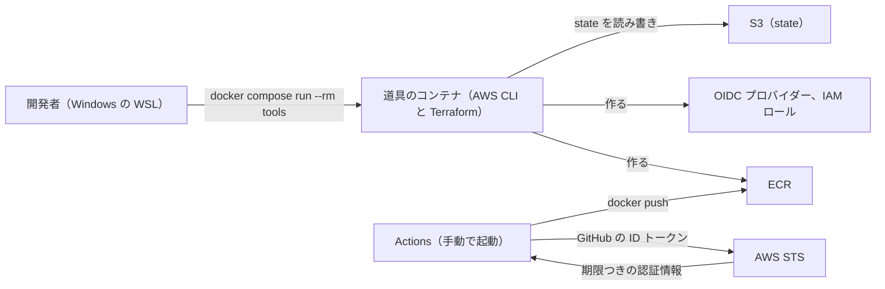

# 0006 AWS の土台と ECR へのイメージの push の設計書

> **状態: 提案。** 2026-11-03 に未決事項を解消した。作成者が実装の段取りを確かめたら承認にする。

| 項目 | 内容 |
|---|---|
| 発信日 | 2026-11-03 |
| 作成者 | ht-0328（Claude Code で作成） |
| 機密区分 | 公開可 |
| 保守責任者 | ht-0328 |
| 最終確認日 | 2026-11-03 |
| 実装 PR | 実装済みにするときに書く |
| 想定読者（宛先） | AWS 化のフェーズ 3 を実装する開発者（人と AI）、レビュアー |
| この文書を読んだあと読者ができること | フェーズ 3 で AWS に作るもの、Terraform のディレクトリと state の置き場所、GitHub Actions から ECR へ push する流れと権限を把握し、追加の質問なしに実装に着手できる |

## 解決する課題

fullstack-lab は、ローカル（Docker Compose）と CI までできており、次は AWS に載せる段階（[ロードマップ](../roadmap/README.md#フェーズ)のフェーズ 3）にある。AWS のアカウントは 2026-11-03 に作成者が用意し、root ユーザーの MFA と予算アラートまで設定した。しかし、AWS を操作する道具も、構成を書くコード（Terraform。AWS の構成をコードで書いて作る道具）も、アプリのコンテナイメージの置き場もまだ無い。この設計書は、フェーズ 4 以降の土台として、手元から AWS を操作する道具、Terraform の state（Terraform が作ったリソースを記録したファイル。失うと、作ったリソースを Terraform で管理できなくなる）の置き場所、ECR（AWS のコンテナイメージの置き場）、GitHub Actions（以下 Actions）が ECR へイメージを push する仕組みを決める。

次の表は、この変更の対象と規模、何ができれば完了かをまとめる。表の「集約リポジトリ」は、領域の 4 つのリポジトリ、infra リポジトリ、図解のリポジトリを git submodule で束ねるこのリポジトリ fullstack-lab で、「領域」は独立したリポジトリで作るアプリの単位である（[用語](../architecture/README.md#用語)）。「infra リポジトリ」は、この変更で新しく作る AWS のインフラのリポジトリ [fullstack-lab-infra](https://github.com/ht-0328/fullstack-lab-infra) で、集約リポジトリの `infra/` に submodule として入る。この設計書の `infra/bootstrap` などのパスは、集約リポジトリから見たパスである。

| 項目 | 内容 |
|---|---|
| 対象 | 手元から AWS を操作する開発者と、アプリのイメージを ECR へ push する人。利用者（アプリを使う人）から見える変化は無い |
| 発生規模（変えるリポジトリと契約の数） | リポジトリ 6 つ（集約リポジトリ、新しく作る infra リポジトリ、領域の 4 つのリポジトリ `web`、`api`、`authz`、`auth`）。契約は変えない |
| 利用者への影響（今できないこと、困っていること） | 今は AWS にイメージを置く場所が無く、フェーズ 4 で ECS（AWS のコンテナ実行サービス）に載せるイメージを用意できない |
| 成功条件 | 領域の 4 つのリポジトリで、Actions の画面から手動で起動したワークフローが、main のコミットのイメージを ECR へ push できる。AWS のリソースはすべて Terraform で作られ、`terraform plan` が差分なしになる。GitHub にも手元にも長期のアクセスキー（期限の無い認証情報）が無い |

## 制約と前提

次の表は、この設計が従う制約と、成り立っているとして進める前提、不確かなまま置く仮定を分けて示す。

| 区分 | 内容 | 根拠 |
|---|---|---|
| 制約 | イメージの push は、main へのマージで自動では行わず、人が Actions を手動で起動して行う | 業務環境（作成者が以前いた職場。[用語](../architecture/README.md#用語)）ではそうしていた（[業務環境について聞いている事実](../architecture/README.md#業務環境について聞いている事実)。2026-11-03 に作成者が確かめた） |
| 制約 | 長期のアクセスキーを作らない。Actions は OIDC（GitHub が発行するトークンで、AWS の期限つきの認証情報を得る仕組み）、手元は `aws login` で認証する | 漏れても期限で使えなくなる認証情報だけを使うため。`aws login` の扱いは [ADR-0005](../adr/ADR-0005-infra-tools-container.md) |
| 制約 | AWS CLI と Terraform はホスト（コンテナを動かす側の環境。作成者の環境では Windows の WSL）に入れず、コンテナで動かす | [ADR-0005](../adr/ADR-0005-infra-tools-container.md)（ラッパーで動かす形を決めた [ADR-0004](../adr/ADR-0004-run-aws-tools-in-docker.md) を置き換えたもの） |
| 制約 | リソースは、マネジメントコンソール（AWS の Web 画面）で 1 回作って理解してから Terraform に書き起こし、コンソールで作ったものは消す | [ロードマップの「フェーズ 3 以降に着手する前に決めること」](../roadmap/README.md#フェーズ-3-以降に着手する前に決めること)（2026-11-01 に作成者が決めた） |
| 制約 | AWS のアカウント ID を、公開のリポジトリ、Actions のログ、文書に出さない | 集約リポジトリ、infra リポジトリ、領域の 4 つのリポジトリ、図解のリポジトリ（GitHub Pages で公開している HTML）と、Actions のログは公開されている。アカウント ID だけで侵入はされないが、狙う相手を絞る手がかりになるため |
| 前提 | AWS アカウントは 1 つで、有料プラン、東京リージョン `ap-northeast-1`。サインアップは従来の形式で行った（新しい形式のアカウントは AWS が管理する Organization に入り、その SCP（Organization が配下のアカウントに課す権限の上限）で OIDC プロバイダーの作成が拒否されるため） | 2026-11-03 に作成者が用意した |
| 前提 | 作成者は IAM（AWS の利用者と権限を管理するサービス）のユーザー `Administrator` で操作する。グループ `Administrators` に、AWS のすべての操作を許す管理ポリシー AdministratorAccess を付けている | 2026-11-03 に作成者が用意した |
| 前提 | IaC（AWS の構成をコードで書くこと）のツールは Terraform | [ロードマップの「IaC」](../roadmap/README.md#iac) |
| 仮定 | この変更だけの仮定は無い。push を手動にするのは業務環境の事実に合わせたもので、構成の仮定には載せない | — |

## 採用案

AWS のインフラのコードは、新しく作る infra リポジトリに置く。手元の AWS CLI と Terraform は、infra リポジトリの道具のコンテナ（両方を入れたコンテナ）に入って動かし、Terraform は state を S3（AWS のファイルの置き場）のバケットに置く。Terraform の `infra/shared` で、ECR のリポジトリ（ECR の中でイメージを置く単位。git のリポジトリとは別）5 つ、GitHub の OIDC プロバイダー、push 用の IAM ロール 4 つを作る。領域の各リポジトリには手動で起動する push 用のワークフローを置き、そのリポジトリ専用のロールに切り替えて、自分のイメージだけを push する。

次の図は、採用案の全体を示す。開発者は道具のコンテナに入り、Terraform で AWS のリソースを作る。Actions は GitHub の ID トークンを AWS STS（期限つきの認証情報を発行するサービス）に渡してロールの認証情報を受け取り、ECR へ push する。

次の表は、採用案を要素ごとに分け、採用内容と責務を示す。表の ARN は、AWS のリソースを一意に指す名前で、アカウント ID を含む。

| 要素 | 採用内容 | 責務 |
|---|---|---|
| infra リポジトリ | `fullstack-lab-infra`（公開）。道具のコンテナ（`Dockerfile`、`compose.yaml`）、`bootstrap`、`shared`、CI を置く。main は他のリポジトリと同じく PR と CI を必須にする | AWS のインフラのコードを、アプリの領域と同じく独立したリポジトリで持つ |
| 手元の道具 | infra リポジトリの `Dockerfile` で、公式の `amazon/aws-cli` のイメージに、公式の `hashicorp/terraform` のイメージから取り出した Terraform を足す。バージョンは 2 つの `FROM` のタグで固定し、AWS CLI は 2.32.0 以上（`aws login` が使えるバージョン）、Terraform は 1.15.0 以上（state を S3 に置く設定の S3 backend が `aws login` の認証情報を読めるバージョン。出所は「実装の段取り」の止まりやすい点）にする。infra リポジトリ（集約リポジトリでは `infra/`）で `docker compose run --rm tools` を打つと中のシェルに入り、`aws login --remote` や `terraform plan` を公式の文書どおりに打てる | 手元から AWS を操作する。決まりと理由は [ADR-0005](../adr/ADR-0005-infra-tools-container.md) |
| `infra/bootstrap` | state 用の S3 バケット 1 つ（バージョニング有効、SSE-S3 で暗号化、パブリックアクセスをすべてブロック）。最初は手元のファイルの state で作り、作ったあと自分の state もそのバケットへ移す | state の置き場所を作る。1 回だけ実行する |
| `infra/shared` | ECR のリポジトリ 5 つ、OIDC プロバイダー、push 用の IAM ロール 4 つ。state は S3 に置き、ロックは S3 のロックファイル（`use_lockfile`）で取る。AWS プロバイダー（Terraform が AWS を操作するための部品）は、`aws login` の認証情報を読める 6.23.0 以上を指定する（出所は「実装の段取り」の止まりやすい点） | 環境（dev など）に依存せず、アカウントに 1 つあればよいものを作る。作っては壊す対象（学習するときだけ作り、終わったら消すもの。[ロードマップの「費用を抑える運用」](../roadmap/README.md#費用を抑える運用)）にしない |
| ECR のリポジトリ | `fullstack-lab/nuxt`、`fullstack-lab/bff`、`fullstack-lab/api`、`fullstack-lab/authz`、`fullstack-lab/auth`。タグは上書き不可（`IMMUTABLE`）、push 時に基本スキャン（無料の脆弱性検査）を行う。ライフサイクルポリシーで、タグ付きの最新 5 個を残し、タグの無いイメージは 1 日で消す | アプリのイメージを置く。5 個残すのは、フェーズ 4 のデプロイで直前のイメージに戻せれば足りるためで、保存料は月 1 ドル未満に収まる |
| OIDC プロバイダー | `token.actions.githubusercontent.com`。オーディエンス（トークンの宛先。JWT の `aud`）は `sts.amazonaws.com` | AWS が GitHub の ID トークンの署名を信用するための登録 |
| push 用の IAM ロール | `fullstack-lab-ecr-push-web`、`-api`、`-authz`、`-auth` の 4 つ。信頼ポリシーは、オーディエンスが `sts.amazonaws.com` で、`sub`（どのリポジトリのどのブランチのジョブか）が `repo:ht-0328/fullstack-lab-<名前>:ref:refs/heads/main` のときだけ切り替えを許す。許可のポリシーは、`ecr:GetAuthorizationToken` と、自分の ECR のリポジトリ（`web` は `nuxt` と `bff`、ほかは同名の 1 つ）に対する `ecr:BatchCheckLayerAvailability`、`ecr:InitiateLayerUpload`、`ecr:UploadLayerPart`、`ecr:CompleteLayerUpload`、`ecr:PutImage`、同じタグがあるかを確かめる `ecr:DescribeImages` だけ | 領域の 1 つのリポジトリの Actions が、自分のイメージだけを push できるようにする |
| push 用のワークフロー | 領域の各リポジトリの `.github/workflows/push-image.yml`。起動は `workflow_dispatch`（Actions の画面の「Run workflow」）だけ。認証は `aws-actions/configure-aws-credentials`（OIDC でロールに切り替える公式のアクション）で行い、アカウント ID をログのマスク（伏せ字にする文字列）に登録する（入力 `mask-aws-account-id`。名前と効き方は「実装の段取り」の 3 で確かめる）。Dockerfile の `runtime` ステージをビルドし、タグはコミットの SHA（40 文字）にする。同じタグが ECR にあれば push しない | main のコミットのイメージを ECR に置く。`web` は `nuxt` と `bff` の 2 つ |
| GitHub の設定 | 領域の各リポジトリの Secret `AWS_ROLE_ARN` に、そのリポジトリ用のロールの ARN を入れる | ロールの ARN に含まれるアカウント ID を、ワークフローのファイルに書かない |
| infra リポジトリの CI | 道具のコンテナのイメージを作り、その中で Terraform の `fmt -check` と `validate` を、AWS の認証情報なしで実行する | 道具のイメージが作れること、Terraform のコードの書式と文法の誤りを PR で見つける |

### 影響するリポジトリ

次の表は、リポジトリごとに変更の有無と内容を示す。集約リポジトリが束ねるリポジトリのうち、図解のリポジトリだけは変えない。

| リポジトリ | 変更 | 変えない理由 |
|---|---|---|
| `api` | `.github/workflows/push-image.yml` を追加 | — |
| `authz` | `.github/workflows/push-image.yml` を追加 | — |
| `auth` | `.github/workflows/push-image.yml` を追加 | — |
| `web` | `.github/workflows/push-image.yml` を追加（`nuxt` と `bff` の 2 つを push） | — |
| 図解（`references/architecture-notes`） | 変えない | 図解は architecture を元に描き直す。architecture に AWS の構成を書くのは「実装の段取り」の 7 なので、図解の描き直しはそのあとに別の PR で行う |
| `infra`（新規） | 道具のコンテナ（`Dockerfile`、`compose.yaml`）、`bootstrap`、`shared`（集約リポジトリから見た `infra/bootstrap`、`infra/shared`）、`.gitignore`（`.terraform/`、`*.tfstate*`、`backend.hcl`）、CI、README | — |
| 集約 | `infra` を submodule として足す。リポジトリの一覧（[README](../../README.md)、[AGENTS.md](../../AGENTS.md)、スキル [pr-and-commit](../../.agents/skills/pr-and-commit/SKILL.md)、[architecture の「用語」](../architecture/README.md#用語)）に `infra` を足す。architecture とロードマップの更新、submodule の参照更新 | — |

### 契約の変更

変えない。この変更はイメージの置き場所と、それを作る仕組みだけを足し、リポジトリ同士の API は変えないため。

### 認可

変えない。新しい操作（`task:xxx`）は増えない。この設計書の「権限」は AWS の IAM の権限で、アプリの認可 API とは別物である。

### テスト

次の表は、層ごとに何を確かめるかを示す。この変更はアプリのコードを変えないので、単体、Karate（API を HTTP で呼んで確かめるテスト）、Playwright（ブラウザで画面を操作するテスト）は今のまま通ればよい。スモークは、集約リポジトリで全体を起動して主要な経路を通すテストである。新しく確かめるのは、Terraform と push の仕組みである。

| 層 | 対象 | 確かめること |
|---|---|---|
| infra リポジトリの CI | 道具のイメージ、`infra/bootstrap` と `infra/shared` | イメージが作れる。`terraform fmt -check` と `terraform validate`（`init -backend=false` で、AWS に接続しない）が通る |
| 手で確かめる（Terraform） | `infra/shared` | `apply` のあとに `plan` を実行し、差分が無い。道具のコンテナで `aws sts get-caller-identity` が `user/Administrator` を返す |
| 手で確かめる（push） | 領域の 4 つのリポジトリ | main で「Run workflow」を押すと、コミットの SHA のタグで ECR にイメージが入る。同じコミットでもう一度押すと push せずに成功する |
| 手で確かめる（守り） | 信頼ポリシー、許可のポリシー、ログ | main 以外のブランチを選んで起動すると、ロールへの切り替えで失敗する。道具のコンテナで `aws iam simulate-principal-policy`（IAM のポリシーを実際には実行せずに評価するコマンド）を打つと、`api` のロールの `ecr:PutImage` が `fullstack-lab/bff` には拒否（`implicitDeny`）になる。ワークフローのログにアカウント ID が出ていない |
| スモーク（集約） | 入口（すべてのリクエストを最初に受けるもの。ローカルは Nginx。[用語](../architecture/README.md#用語)）から DB まで | 今のまま通る（アプリを変えないことの確認） |

## 比較した代替案とトレードオフ

次の表は、検討した案を採用案も含めて並べ、採否の理由を示す。判断は 2026-11-03 に作成者が行った。表の publish は、契約から生成したクライアントを Maven リポジトリに登録して配布することである（[用語](../architecture/README.md#用語)）。

| 案 | 利点 | 欠点 | 採否の理由 |
|---|---|---|---|
| push は手動で起動する（採用） | いつ、どのコミットを AWS に置くかを人が決められる | 押し忘れると ECR のイメージが古いまま | 業務環境と同じで、押し忘れても困るのはフェーズ 4 のデプロイのときだけ |
| main へのマージで自動で push する | 押し忘れが無い。一般の開発では多い形 | AWS に置くタイミングを選べない | 不採用。業務環境と違う |
| 領域の各リポジトリが自分のイメージを push する（採用） | イメージがそのリポジトリの成果物になり、ロールもリポジトリごとに絞れる。クライアントの publish と同じ形 | ワークフローが 4 つに分かれる | 1 つのリポジトリが乗っ取られても、ほかのイメージを書き換えられない |
| 集約リポジトリがまとめて push する | ワークフローとロールが 1 つで済む | アプリを直しても、集約リポジトリの参照を進めるまで push できない。ロールが全部のイメージに push できる | 不採用。権限が広く、アプリの変更から push までが遠い |
| インフラのコードを infra リポジトリに置く（採用） | アプリの領域と同じく、変更と CI と main の保護がリポジトリごとに閉じる。アプリの PR とインフラの PR が混ざらない | リポジトリが 1 つ増え、集約リポジトリの参照更新も要る | 領域ごとにリポジトリを分ける今の構成に合わせる |
| インフラのコードを集約リポジトリの `infra/` に直接置く | リポジトリが増えない | 集約リポジトリの PR にインフラの変更が混ざる。インフラの CI と main の保護を、集約リポジトリのものと分けられない | 不採用。アプリの領域はリポジトリごとに分けており、インフラだけ集約リポジトリに置くと分け方がそろわない |
| ロールをリポジトリごとに 1 つ（採用） | 権限が最小になる | ロールが 4 つになる | IAM ロールは無料で、Terraform では 1 つの定義を 4 回使うだけで済む |
| ロールを 4 リポジトリで 1 つ共有 | ロールが 1 つで済む | どのリポジトリからでも全部のイメージに push できる | 不採用。権限が広い |
| state を S3 に置く（採用） | PC を変えても失わない。一般の業務でも広く使われる形 | 最初にバケットを作る手順が要る | 費用は月数セントで、失ったときの復旧（既存のリソースを 1 つずつ取り込み直す）のほうが重い |
| state を手元のファイルに置く | 準備が要らない | 消すと Terraform が作ったものを管理できなくなる | 不採用。PC の故障やファイルの削除で state を失うと、作ったリソースを 1 つずつ取り込み直すことになる |
| イメージのタグをコミットの SHA にする（採用） | どのコミットのイメージかが一意に分かり、上書き不可と両立する | タグを見てもどちらが新しいかが読めない | フェーズ 4 のデプロイで「どのコミットを載せたか」を確かめられる |
| イメージのタグを `latest` にする | 指定が簡単 | 中身が入れ替わり、何が動いているか分からなくなる | 不採用。上書き不可にできない |

## 失敗時の動作

次の表は、失敗の条件ごとの動作を示す。どれもアプリの利用者には影響しない。

| 失敗条件 | 検知方法 | システムの動作 | 開発者への影響 |
|---|---|---|---|
| `aws login` の認証情報が期限切れ | 道具のコンテナの `aws` や `terraform` が認証エラーで止まる | 何も作らない | 道具のコンテナで `aws login --remote` を打ち、ログインし直す |
| Terraform が `aws login` の認証情報を読めない | `terraform plan` が `No valid credential sources found` で止まる | 何も作らない | 同じコンテナで `eval "$(aws configure export-credentials --format env)"` を打ち、期限つきの認証情報を環境変数に入れてから `terraform` を打つ。この回避策で動いたら、手順を「採用案」の手元の道具の行と infra リポジトリの README に書き足す |
| state のロックが残っている | `terraform plan` がロックの取得で止まる | 何も作らない | 他に実行中の Terraform が無いことを確かめてから `terraform force-unlock` で外す |
| main 以外のブランチで push を起動した | `aws-actions/configure-aws-credentials` がロールへの切り替えで失敗する | ワークフローが失敗し、何も push しない | main を選んで起動し直す |
| 同じコミットのイメージが既にある | ワークフローが `ecr:DescribeImages` でタグがあるかを確かめる | push せずに成功で終わる | 何もしなくてよい |
| `bff` のビルドで生成クライアントを取得できない | `docker build` が依存の解決で失敗する | 何も push しない | 今の CI と同じく、`api` / `authz` / `auth` のクライアントが GitHub Packages（CI で生成クライアントを置いている Maven リポジトリ）に publish 済みかを確かめる |
| 予算（月 10 ドル）を超えそう | AWS Budgets がメールで通知する | 課金は止まらない | 何が費用を出しているかを Billing の画面で確かめ、要らないものを消す |

## 技術観点の確認

### セキュリティと権限

次の表は、セキュリティの観点ごとに、この変更での扱いを示す。

| 観点 | 内容 |
|---|---|
| 認証 | 手元は `aws login`（期限つき）、Actions は OIDC（ジョブごとに期限つき）。長期のアクセスキーは作らない |
| 認可 | push 用のロールは、信頼ポリシーで「そのリポジトリの main のジョブ」だけに絞り、許可のポリシーで「自分の ECR のリポジトリへの push」だけに絞る。Terraform は作成者の `Administrator` で実行する |
| 秘密情報の保管 | ロールの ARN は領域の各リポジトリの Secret に置く。state のバケット名は、すべてのアカウントで一意にするためにアカウント ID を含めるので、`infra/*/backend.hcl`（git の管理外）に書き、リポジトリには `backend.hcl.example` だけを置く。`~/.aws` はコミットしない |
| 通信の暗号化 | AWS の API と ECR への push は HTTPS。state のバケットは SSE-S3 で暗号化する |
| 監査ログ | CloudTrail の既定の記録（90 日分の管理操作のイベント履歴。無料）で、誰がいつロールに切り替え、何を作ったかを追える。追加の設定はしない |

### データ

次の表は、データの観点ごとの扱いを示す。

| 観点 | 内容 |
|---|---|
| 扱う個人情報 | 扱わない。ECR に置くのはアプリのイメージだけで、個人情報も秘密情報も含まない。BFF のビルドで使う GitHub Packages の資格情報は、今の CI と同じく build secret で渡し、イメージに残さない |
| 保持期間と削除 | イメージはライフサイクルポリシー（タグ付きの最新 5 個を残し、タグの無いものは 1 日で消す）に任せる。state にはリソースの ID と ARN が入るので、バケットは非公開にする。state の過去のバージョンはバージョニングで残り、「展開と後始末」の切り戻しでバケットを消すときに消える |
| 移行 | 無い。アプリのデータと DB は変えない |
| 容量の見込み | イメージは ECR のリポジトリ 5 つにそれぞれ最新 5 個までで、保存料は月 1 ドル未満（「採用案」の表の ECR のリポジトリの行） |

### 性能と可用性、可観測性

目標値は置かない。学習用の構成で、push は人が手で起動するたびに 1 回だけ動くためである。push のワークフローの所要時間（Gradle のビルドを含むので数分）は、今の CI の単体テストのジョブと同じ程度になる。

### 展開と後始末

次の表は、展開後に戻す方法と互換性を示す。

| 観点 | 内容 |
|---|---|
| 切り戻し | 道具のコンテナの中で `shared`（集約リポジトリから見た `infra/shared`）に移り、`terraform destroy` を実行して消す。ECR のリポジトリにイメージがあると消せないので、先にイメージを消す。state のバケットは最後に手で消す |
| 互換性 | アプリと、Compose で動くローカルの構成は変わらない。push のワークフローを消せば元に戻る |
| 廃止計画 | なし。`infra/shared` はフェーズ 4 以降も使い続け、作っては壊す対象にしない（保存料は月 1 ドル未満） |

## 実装の段取り

次の表は、実装の順序と、各段を終えてよい条件を示す。コンソールで 1 回作ってから Terraform に書き起こす決まり（「制約と前提」の節）に合わせ、2〜4 で state のバケットと `api` の分だけをコンソールで作って試し、消してから 5 で Terraform にする。AWS の画面操作、Actions の起動、GitHub のリポジトリの作成と main の保護は作成者が手で行う。

| 順 | リポジトリ / 場所 | やること | 終えてよい条件 | 待つもの |
|---|---|---|---|---|
| 1 | `infra`（新規）、集約 | infra リポジトリを作り、道具のコンテナ、`.gitignore`、CI、README を置く。CI が通ったら、作成者が GitHub の設定で main を、PR と CI の成功が無いとマージできないようにする。集約リポジトリに `infra` を submodule として足し、リポジトリの一覧（「影響するリポジトリ」の集約の行）を直す | 作成者が道具のコンテナの中で `aws login --remote` を打ってログインでき、`aws sts get-caller-identity` が `user/Administrator` を返す。infra リポジトリの最初の PR と、集約リポジトリに `infra` を足す PR がマージされた | なし |
| 2 | AWS の画面（手） | state 用の S3 バケット（バージョニング有効、SSE-S3、パブリックアクセスをすべてブロック）、ECR のリポジトリ `fullstack-lab/api`、OIDC プロバイダー、ロール `fullstack-lab-ecr-push-api` を作る。`api` の Secret `AWS_ROLE_ARN` を設定する | 4 つが画面で確認できる | 1 |
| 3 | `api` | `push-image.yml`。`aws-actions/configure-aws-credentials` の入力 `mask-aws-account-id` の名前と効き方を確かめる。マージ後に main で「Run workflow」を押す | PR がマージされ、ECR にコミットの SHA のタグのイメージが入る。main 以外のブランチでは失敗する。ログにアカウント ID が出ていない | 2 |
| 4 | AWS の画面（手） | 2 で作った 4 つとイメージを消す | 画面から 4 つが消えている | 3 |
| 5 | `infra` | `infra/bootstrap`（state のバケット）と `infra/shared`（ECR のリポジトリ 5 つ、OIDC プロバイダー、ロール 4 つ）。`apply` は作成者が道具のコンテナで実行する | `plan` が差分なし。CI が通り、PR がマージされた | 4 |
| 6 | `api`、`authz`、`auth`、`web` | `authz`、`auth`、`web` に `push-image.yml` を足し、4 つの Secret を 5 のロールの ARN にする。それぞれ main で「Run workflow」を押す | PR がマージされ、5 つのイメージが ECR に入る。「テスト」の節の守りの確認が済んだ | 5 |
| 7 | 集約 | submodule の参照更新。architecture（AWS の構成）とロードマップ（フェーズ 3 を完了、`infra/` の構成）を今の状態に合わせ、この設計書を実装済みにする | CI（スモーク、Karate、Playwright）が通りマージされた | 6 |

次の点で止まりやすい。

- 1 の `aws login --remote` は、作成者が Windows のブラウザで URL を開いてサインインし、表示されたコードをターミナルに貼る。所要は数分。
- Terraform の AWS プロバイダーは 6.23.0 から、Terraform 本体の S3 backend（state を S3 に置く設定）は 1.15.0 から、`aws login` の認証情報を読めると、公開の検証記事「[Terraform S3 Backend で aws login 認証が使えるか検証してみた](https://dev.classmethod.jp/articles/terraform-s3-backend-aws-login/)」（Classmethod）にある。AWS と HashiCorp の公式の文書では確かめていない。5 の最初にこれを確かめ、読めなければ「失敗時の動作」の節の回避策で進める。
- 2 で作った OIDC プロバイダーを 4 で消し忘れると、5 の `apply` が「既にある」で失敗する。

## 未決事項

なし。2026-11-03 に作成者に次の点を確かめ、本文に反映した。

- push の起動は手動（`workflow_dispatch`）にする。main へのマージで自動で push しないのは業務環境の事実でもある
- push のワークフローは領域の各リポジトリに置く
- push 用のロールはリポジトリごとに 1 つ（4 つ）にする。IAM ロールと OIDC プロバイダーに費用はかからない
- Terraform の state は S3 に置く
- インフラのコードは、集約リポジトリに直接置かず、独立した infra リポジトリ（`fullstack-lab-infra`）に置く

## 課題・申し送り事項

- Nginx と Keycloak のイメージは含めない。どちらも設定ファイル（`nginx/`、`auth/keycloak/`）を入れたイメージにするかを、ECS に載せるフェーズ 4 で決める。
- `infra/envs/dev`（作っては壊す環境ごとの構成）とモジュールは、フェーズ 4 で足す。[ロードマップの「IaC」](../roadmap/README.md#iac)の節は、「実装の段取り」の 7 で、`infra/bootstrap` と `infra/shared` を加えた構成に直す。
- Terraform は手元からだけ実行し、Actions からは実行しない。Actions から `plan` や `apply` を行うかは、フェーズ 4 で決める。
- フェーズ 6 で CodeBuild（AWS のビルド実行サービス）を入れると、ECR への push は CodeBuild に移る（[ロードマップの「GitHub Actions と CodeBuild の責務分担」](../roadmap/README.md#github-actions-と-codebuild-の責務分担)）。そのとき、この設計の push 用のワークフローとロールを見直す。
