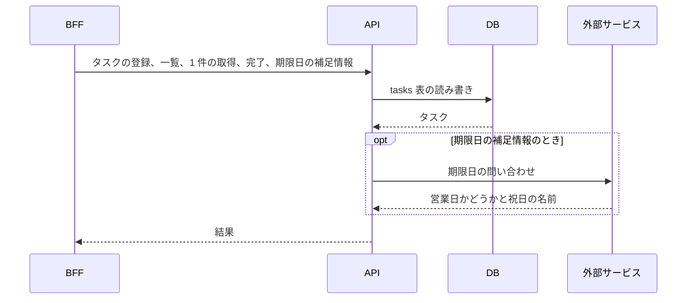
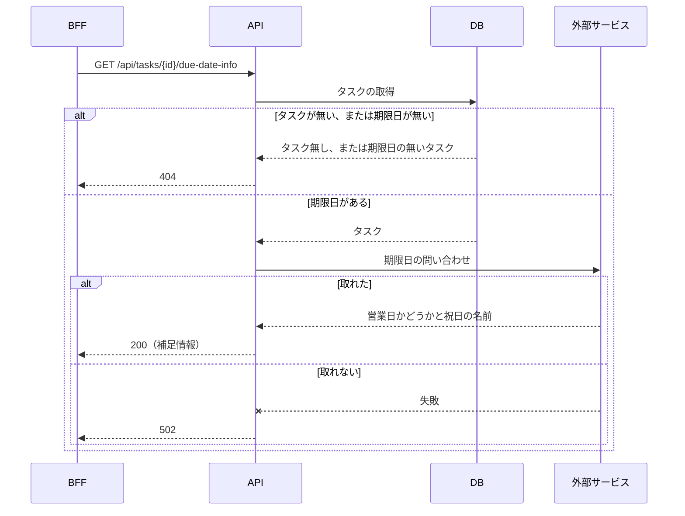
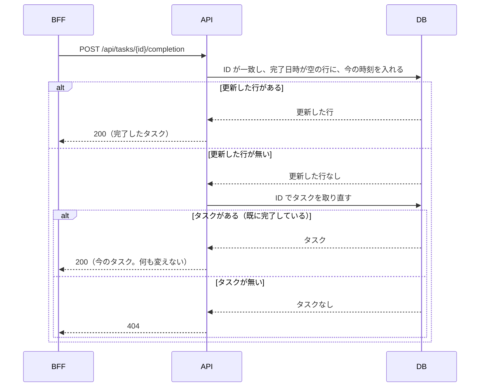

# API（タスクの API）の全体像

この文書は、`api` リポジトリが作る API の全体像と、このフォルダの文書の案内を記す。API はタスクを保存して返すサービスで、BFF（画面専用のサーバー側 API。[用語](../../architecture/README.md#用語)）からだけ呼ばれる。細かい決まりは、作るもの 1 つにつき 1 本の文書に分けてあり、この文書には書かない。リクエストと応答の項目は、契約（領域同士の API の取り決め。[用語](../../architecture/README.md#用語)）の [api.yaml](../../../api/openapi/api.yaml) にある。

## このフォルダで使う語

次の表は、このフォルダの文書で使う語のうち、architecture の「用語」の表に無い製品名と仕組みの意味を示す。「用語」の表にある語（BFF、JWT、入口、契約、冪等、縮退 など）の意味は、[architecture の「用語」](../../architecture/README.md#用語) にある。個別の文書は、これらの語に一言を繰り返さない。

| 語 | 意味 |
|---|---|
| PostgreSQL | API がタスクを保存する DB の製品 |
| Flyway | DB の表の作成と変更を、バージョンを付けた SQL ファイルで行うツール |
| 外部サービス（カレンダー API） | 日付が営業日か祝日かを返す API。API が期限日の補足情報を取るために呼ぶ |
| WireMock | HTTP の応答を定義して返すスタブサーバー。ローカルでは外部サービスの代わりに使う |
| Problem Details | RFC 9457 が決める、エラーの内容を JSON で返す標準の形（`application/problem+json`） |
| Karate | API を HTTP で呼んで確かめるテスト |

## 処理の流れ

この節は、API がリクエストを処理する順序を、シーケンス図で示す。どの図も、誰が誰をどの順に呼ぶか、呼ぶ先のパス、ステータスコード、主な分岐までを描き、値や理由は個別の文書に書く。

### 共通の流れ

次の図は、BFF が API を呼んでから、API が結果を返すまでの流れを示す。外部サービスは、日付が営業日か祝日かを返すカレンダー API である。

- BFF が、認証と認可を済ませてから API を呼ぶ。API は、認証も認可も行わない（[呼び出し元と受け取るヘッダー](callers-and-headers.md)）

### 期限日の補足情報

次の図は、API が `GET /api/tasks/{id}/due-date-info` を受けてから、補足情報を返すまでの流れを示す。

外部サービスの呼び方と、ローカルでの代わりは [期限日の補足情報](due-date-info.md) にある。

### タスクの完了

次の図は、API が `POST /api/tasks/{id}/completion` を受けてから、タスクを返すまでの流れを示す。

何回呼んでも結果が同じになる理由と決まりは [タスクの完了](task-completion.md) にある。

## 文書の一覧

次の表は、このフォルダの文書と、それぞれの内容を示す。

| 文書 | 内容 |
|---|---|
| [呼び出し元と受け取るヘッダー](callers-and-headers.md) | API の呼び出し元と、API が受け取るヘッダー |
| [タスクの一覧](task-list.md) | タスクの一覧を返す処理 |
| [タスクの登録](task-create.md) | タスクを登録する処理と、入力の検証 |
| [タスクの取得](task-get.md) | タスクを 1 件返す処理 |
| [期限日の補足情報](due-date-info.md) | 期限日の補足情報を返す処理と、外部サービスの呼び出し |
| [タスクの完了](task-completion.md) | タスクを完了にする処理 |
| [`tasks` 表](tasks-table.md) | DB の表と列 |
| [エラー応答](error-responses.md) | エラーの形と、ステータスコードごとの条件 |

## 関連

次の文書は、API を変えるときに合わせて開くものである。

- 構成全体と用語: [architecture](../../architecture/README.md)
- API を呼ぶ側: [BFF と画面の全体像](../web/README.md)
- 契約: [api.yaml](../../../api/openapi/api.yaml)
