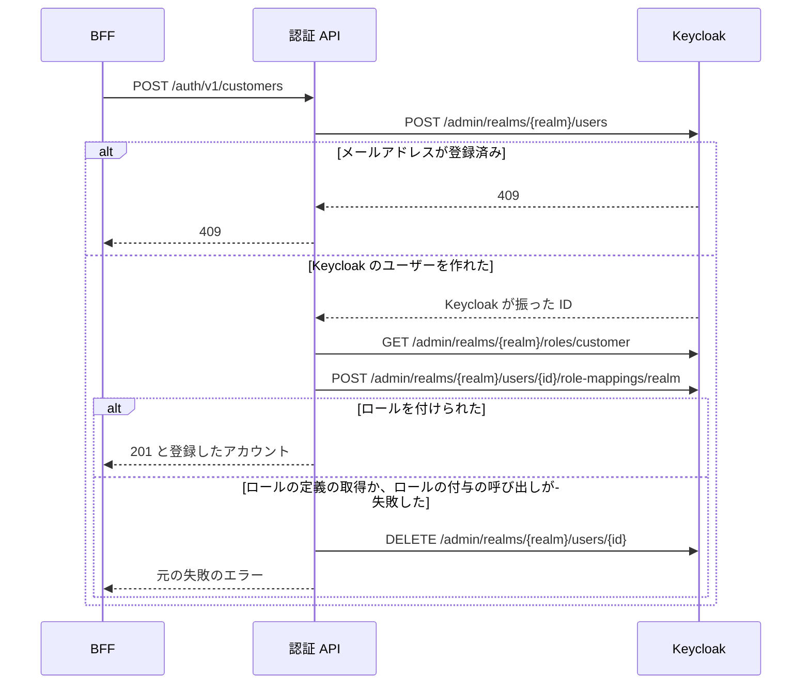
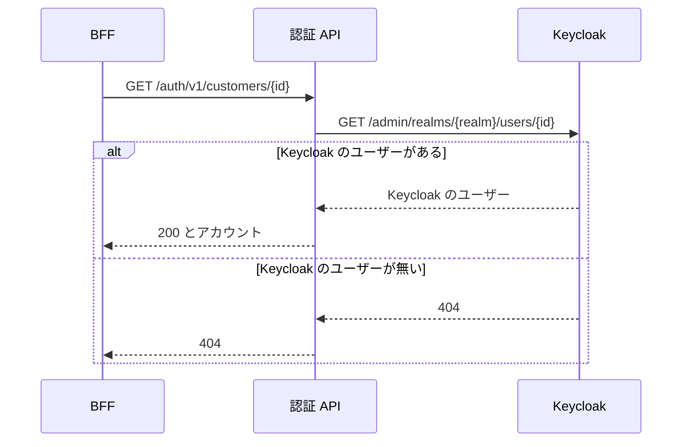
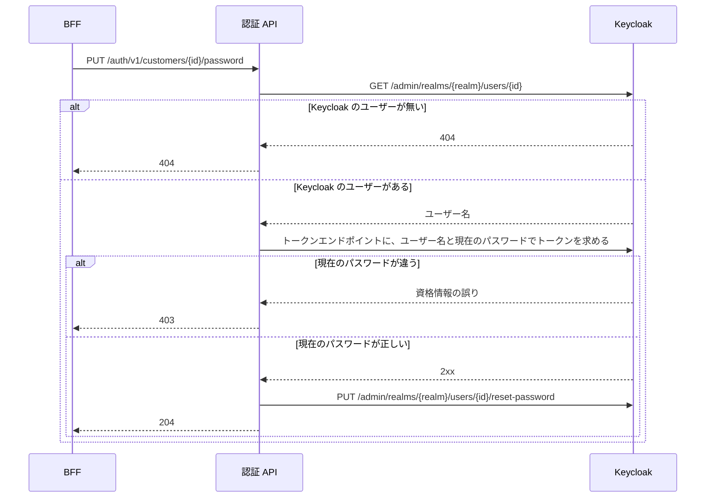

# 認証 API の全体像

この文書は、`auth` リポジトリが作る認証 API の全体像と、このフォルダの文書の案内を記す。認証 API は、一般利用者のアカウントの登録、参照、パスワード変更を、Keycloak（一般利用者の IdP。ログインを受け付けてトークンを発行するサービス。[用語](../../architecture/README.md#用語)）の Admin REST API（Keycloak に登録されたアカウントの作成や更新を行う管理用の API。以下 Admin API）を呼んで行う。認証 API は、ログイン（トークンの発行）を担当せず、社員のアカウントも扱わない（[仮定 12](../../architecture/README.md#仮定)）。細かい決まりは、作るもの 1 つにつき 1 本の文書に分けてあり、この文書には書かない。

この文書では、アプリを使う人を「利用者」、Keycloak に登録されたアカウントを「Keycloak のユーザー」と書き分ける。

## このフォルダで使う語

次の表は、このフォルダの文書で使う語のうち、architecture の「用語」の表に無い製品名と仕組みの意味を示す。「用語」の表にある語（BFF、JWT、IdP、入口、契約 など）の意味は、[architecture の「用語」](../../architecture/README.md#用語) にある。個別の文書は、これらの語に一言を繰り返さない。

| 語 | 意味 |
|---|---|
| Keycloak | 一般利用者の IdP として動かす製品 |
| Keycloak のユーザー | Keycloak に登録されたアカウント。アプリを使う人は「利用者」と書き分ける |
| realm | Keycloak の中で、Keycloak のユーザーとクライアントをまとめる区画 |
| realm ロール | realm に定義するロール。一般利用者を示す `customer` を使う |
| `realm-management` | realm の管理権限のロールをまとめた、Keycloak の組み込みのクライアント |
| Admin API | Keycloak の Admin REST API。Keycloak に登録されたアカウントの作成や更新を行う管理用の API |
| トークンエンドポイント | Keycloak がトークンを発行する URL（`/realms/{realm}/protocol/openid-connect/token`） |
| クライアント | Keycloak にトークンを求めるアプリの登録 |
| クライアントシークレット | クライアントが Keycloak に自分を示すための秘密の値 |
| サービスアカウント | Keycloak のユーザーのログインを介さず、クライアント自身の権限でトークンを得る仕組み |
| Direct Access Grants | ユーザー名とパスワードを直接送ってトークンを得るフロー |
| 認可コードフロー | ブラウザを Keycloak のログイン画面に送り、戻ってきたコードをトークンに換えるフロー |
| PKCE | コードを横取りされても使えなくする仕組み |
| Problem Details | RFC 9457 が決める、エラーの種類、ステータスコード、説明の `detail` などを JSON で返す標準の形（`application/problem+json`） |
| Karate | API を HTTP で呼んで確かめるテスト |
| `MockRestServiceServer` | HTTP の応答を差し替える、Spring のテスト用の部品 |

## 処理の流れ

BFF（画面専用のサーバー側 API。[用語](../../architecture/README.md#用語)）だけが認証 API を呼び、認証 API だけが Admin API を呼ぶ。この節の図は、操作ごとに、BFF、認証 API、Keycloak の間のやり取りを示す。

- 認証 API は、呼び出し元を認証せず、認可も行わない。誰が誰のアカウントを操作してよいかは、BFF が決める（[呼び出し元と受け取るヘッダー](callers-and-headers.md)）
- 認証 API は、データを自分では持たない。アカウントは Keycloak のユーザーとして Keycloak が持つ（[Keycloak の realm `customer` の定義](keycloak-realm-customer.md)）
- 認証 API は、Keycloak の失敗を、決まった形のエラーに変えて返す（[エラー応答](error-responses.md)）

### アカウントの登録

次の図は、アカウントの登録の流れを示す。

呼び出しごとの値と条件は [アカウントの登録](customer-signup.md) にある。

### アカウントの参照

次の図は、アカウントの参照の流れを示す。

返す項目と、欠けた項目の扱いは [アカウントの参照](customer-get.md) にある。

### パスワードの変更

次の図は、パスワードの変更の流れを示す。

呼び出しごとの値と条件、現在のパスワードの確認の方法は [パスワードの変更](password-change.md) にある。

## 文書の一覧

次の表は、このフォルダの文書と、それぞれの内容を示す。リクエストと応答の項目は、契約（領域同士の API の取り決め。[用語](../../architecture/README.md#用語)）の [auth.yaml](../../../auth/openapi/auth.yaml) にある。

| 文書 | 内容 |
|---|---|
| [呼び出し元と受け取るヘッダー](callers-and-headers.md) | 認証 API の呼び出し元と、認証 API が受け取るヘッダー |
| [アカウントの登録](customer-signup.md) | 一般利用者のアカウントを登録する処理 |
| [アカウントの参照](customer-get.md) | アカウントを 1 件返す処理 |
| [パスワードの変更](password-change.md) | パスワードを変える処理と、現在のパスワードの確認 |
| [Admin API 用のトークン](keycloak-admin-token.md) | Admin API を呼ぶためのトークンの取得と使い回し |
| [稼働の確認（`GET /actuator/health`）](health.md) | 認証 API が動いているかを返すエンドポイントと、起動時の動作 |
| [Keycloak への接続の設定](keycloak-connection.md) | Keycloak への接続先、タイムアウト、環境変数 |
| [Keycloak の realm `customer` の定義](keycloak-realm-customer.md) | realm `customer`（Keycloak の中で、Keycloak のユーザーとクライアントをまとめる区画）の設定、クライアント、ロール |
| [エラー応答](error-responses.md) | エラーの形と、ステータスコードごとの条件 |

## 関連

次の文書は、認証 API を変えるときに合わせて開くものである。

- 構成全体と用語: [architecture](../../architecture/README.md)
- `auth` リポジトリの起動とテストの手順: [auth の README](../../../auth/README.md)
