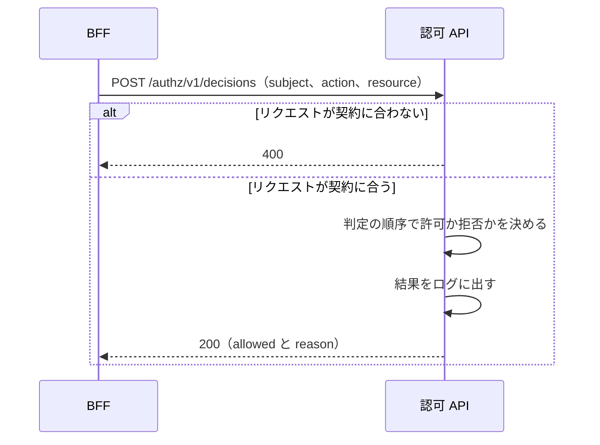

# 認可 API の全体像

この文書は、`authz` リポジトリが作る認可 API の全体像と、このフォルダの文書の案内を記す。認可 API は、主体（操作をしようとしている利用者）、操作、対象を受け取り、その操作をしてよいかを返す API で、BFF（画面専用のサーバー側 API。[用語](../../architecture/README.md#用語)）からだけ呼ばれる。細かい決まりは、作るもの 1 つにつき 1 本の文書に分けてあり、この文書には書かない。リクエストと応答の項目は、契約（領域同士の API の取り決め。[用語](../../architecture/README.md#用語)）の [authz.yaml](../../../authz/openapi/authz.yaml) にある。

## このフォルダで使う語

次の表は、このフォルダの文書で使う語のうち、architecture の「用語」の表に無い製品名、仕組み、このアプリの語の意味を示す。「用語」の表にある語（BFF、JWT、IdP、入口、契約 など）の意味は、[architecture の「用語」](../../architecture/README.md#用語) にある。個別の文書は、これらの語に一言を繰り返さない。

| 語 | 意味 |
|---|---|
| 主体 | 操作をしようとしている利用者。リクエストの `subject` |
| ロール | 社員に付ける権限の名前。IdP のグループ名と同じ |
| Spring Boot | Web アプリを作る Java 系のフレームワーク。認可 API はこれで作る |
| Actuator | アプリの状態を HTTP で返す Spring Boot の機能 |
| Problem Details | RFC 9457 が決める、エラーの内容を JSON で返す標準の形（`application/problem+json`） |
| Karate | API を HTTP で呼んで確かめるテスト |

## 処理の流れ

BFF は、検証済みの JWT（IdP が署名して発行するトークン。[用語](../../architecture/README.md#用語)）から主体を組み立て、操作と対象を添えて認可 API に渡す。認可 API は、設定ファイルから許可する操作の一覧を読んで判定する。

### 判定

次の図は、BFF が認可 API に操作の可否を問い合わせてから応答を受け取るまでの流れを示す。

- 認可 API は、利用者の種別で判定の方法を分ける。社員はロールで、一般利用者は対象の所有者かどうかで判定する（[判定の順序](decision-order.md)）
- 認可 API は、拒否もエラーにはせず、許可かどうかと理由を返す（[判定のエンドポイント](decision-endpoint.md)）
- 認可 API は、DB も他のサービスも使わない（[判定のエンドポイント](decision-endpoint.md)）

エンドポイントの細部は [判定のエンドポイント](decision-endpoint.md) に、許可と拒否を決める順序の図は [判定の順序](decision-order.md) にある。

## 文書の一覧

次の表は、このフォルダの文書と、それぞれの内容を示す。

| 文書 | 内容 |
|---|---|
| [判定のエンドポイント](decision-endpoint.md) | 認可 API の呼び出し元、エンドポイントの応答、判定のログ、エラーの条件 |
| [判定の順序](decision-order.md) | 許可と拒否を決める順序と、判定に使わない項目 |
| [操作ごとの可否](action-permissions.md) | 利用者の種別とロールごとの、操作の可否 |
| [判定の理由（`reason`）の文字列](reason-strings.md) | 応答とログの理由に入る文字列 |
| [設定](settings.md) | 設定ファイルのキーと、それぞれが決めること |
| [操作とロールの追加](adding-actions-and-roles.md) | 操作やロールの追加で変える場所 |

## 関連

次の文書は、認可 API を変えるときに合わせて開くものである。

- 構成全体と用語: [architecture](../../architecture/README.md)
- 認可 API を呼ぶ側: [BFF と画面の全体像](../web/README.md)
- 契約: [authz.yaml](../../../authz/openapi/authz.yaml)
