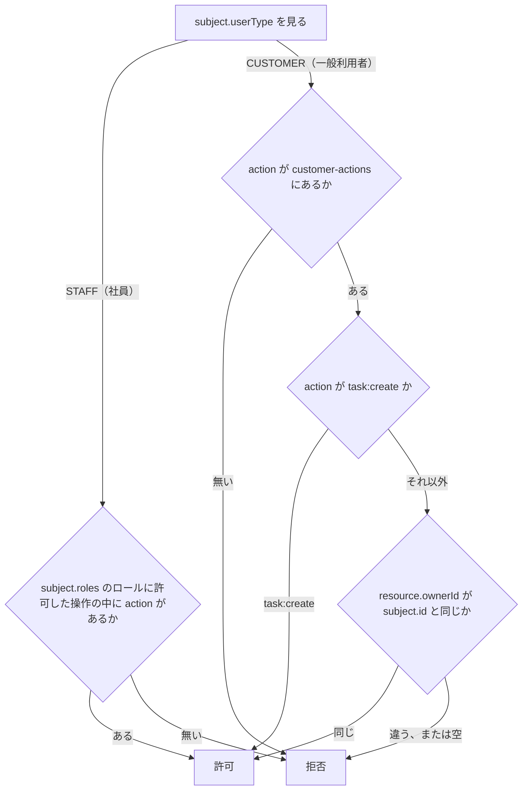

# 判定の順序

この文書は、`authz` リポジトリが作る認可 API が、許可か拒否かを決める順序を記す。認可 API は、主体（操作をしようとしている利用者）、操作、対象を受け取り、その操作をしてよいかを返す API で、BFF（画面専用のサーバー側 API。[用語](../../architecture/README.md#用語)）からだけ呼ばれる。リクエストの項目（`subject`、`action`、`resource`）は、契約（領域同士の API の取り決め。[用語](../../architecture/README.md#用語)）の [authz.yaml](../../../authz/openapi/authz.yaml) にある（[仮定 4](../../architecture/README.md#仮定)）。

このフォルダの全体と、使う語の意味は [認可 API の全体像](README.md) にある。

## 利用者の種別ごとの判定の方法

認可 API は、利用者の種別で判定の方法を分ける。社員はロール（社員に付ける権限の名前。IdP のグループ名と同じ）で判定し、一般利用者は対象の所有者かどうかで判定する（[仮定 5、6](../../architecture/README.md#仮定)）。IdP は、ログインを受け付けてトークンを発行するサービスである（[用語](../../architecture/README.md#用語)）。

## 順序

認可 API は、次の順序で判定し、最初に当たった決まりで結果を決める。どれにも当たらなければ拒否する。設定 `staff-role-permissions` と `customer-actions` の中身は [設定](settings.md) にある。

次の図は、判定の順序を示す。ひし形は認可 API が確かめることで、図に無い条件は、図の次の箇条書きにある。

- 社員が複数のロールを持つとき、認可 API はロールごとに設定 `staff-role-permissions` から許可する操作を集め、`action` がその中に 1 つでもあれば許可する
- `resource.ownerId` が空（全件を対象にする）のときは、`subject.id` と同じにならないので、一般利用者の `task:create` 以外の操作は拒否になる

設定に無いロールは、許可する操作が 0 件のロールとして扱う。そのため、ロールが空の社員と、設定に無いロールだけを持つ社員は、どの操作も拒否される。

## 判定に使わない項目

次の一覧は、判定に使わない項目を示す。BFF はこれらを渡すが、値を変えても結果は変わらない。

- `resource.type`（`task`、`account` など）。認可 API は、対象の種類を `action` の名前（`task:read` の `task`）だけで区別する
- 社員のときの `resource.ownerId`。社員は、ロールに操作があれば、誰のものでも操作できる
- 一般利用者のときの `subject.roles`

## テスト

次の表は、`authz` リポジトリの中で確かめることを示す。Karate は、API を HTTP で呼んで確かめるテストである。

| 層 | 場所 | 確かめること |
|---|---|---|
| 単体 | `authz/src/test/` の `PolicyTest` | 一般利用者が自分のタスクだけを操作でき、所有者が空の一覧と完了が拒否されること。社員の可否がロールで決まること。設定に無い操作とロールが拒否されること |
| Karate | `authz/karate/features/decisions.feature`（`authz/compose.test.yaml` で認可 API を起動して実行） | ロールが空の社員が拒否されること |

単体テストは、設定ファイルを読まず、テストの中で組み立てた操作の一覧で判定を確かめる。`application.yml` の値そのものを確かめるのは Karate である。
