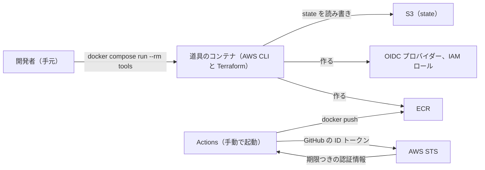
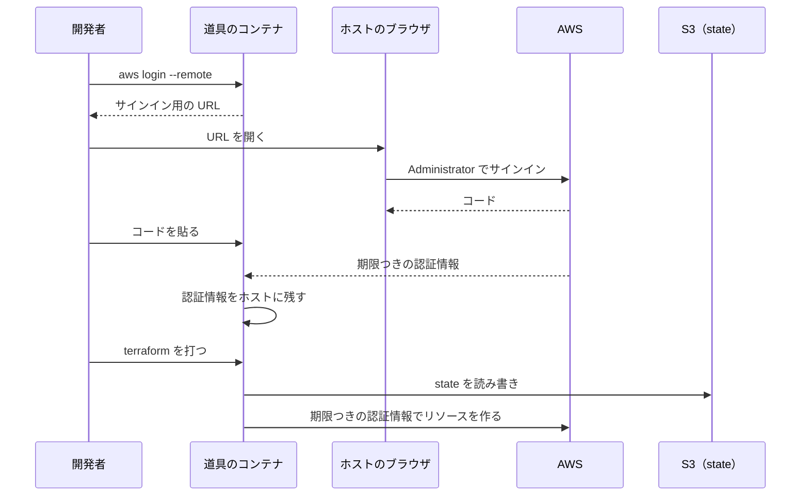
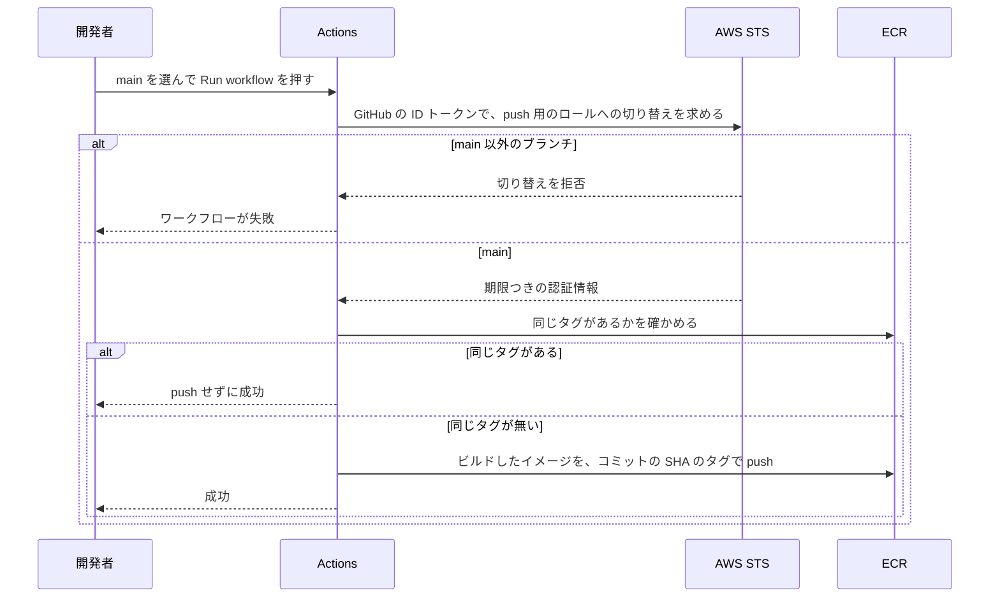

# インフラ（AWS の共通のリソースと、ECR へのイメージの push）の全体像

この文書は、`infra` リポジトリ（AWS のインフラのリポジトリ [fullstack-lab-infra](https://github.com/ht-0328/fullstack-lab-infra)。集約リポジトリの `infra/` に submodule として入る）が作るもの（AWS の共通のリソースと、ECR へイメージを push する仕組み）の全体像を記す。作るものは、手元（開発者が作業する PC。[用語](../../architecture/README.md#用語)）から AWS を操作する道具のコンテナ、Terraform の state の置き場所、ECR、GitHub Actions（以下 Actions）が ECR へイメージを push する仕組みの 4 つである。Terraform は AWS の構成をコードで書いて作る道具、state は Terraform が作ったリソースを記録したファイル、ECR は AWS のコンテナイメージの置き場である。細かい設定は、作るものごとの文書に書き、この文書には書かない。

このフォルダの文書は、作る形を書き、AWS アカウントが [architecture の「AWS アカウント」](../../architecture/README.md#aws-アカウント) に書いた状態であることを前提にする。作業の進み具合は issue [#13](https://github.com/ht-0328/fullstack-lab/issues/13) にある。

この文書の範囲は、[ロードマップの「フェーズ」](../../roadmap/README.md#フェーズ)の 3 に当たり、ECS（AWS のコンテナ実行サービス）や VPC（AWS 上の専用ネットワーク）は扱わない。

## このフォルダで使う語

次の表は、このフォルダの文書で使う語のうち、architecture の「用語」の表に無い製品名と仕組みの意味を示す。「用語」の表にある語（手元、ホスト、IAM、IAM ロール、OIDC、ECR、S3、ARN、state、領域、集約リポジトリ、publish など）の意味は、[architecture の「用語」](../../architecture/README.md#用語) にある。個別の文書は、これらの語に一言を繰り返さない。

| 語 | 意味 |
|---|---|
| Terraform | AWS の構成をコードで書いて作る道具 |
| AWS プロバイダー | Terraform が AWS を操作するための部品 |
| S3 backend | Terraform の state を S3 に置く設定 |
| ロック | 2 つの Terraform が同時に state を書き換えないようにする仕組み |
| AWS CLI | AWS をコマンドで操作する公式の道具 |
| 道具のコンテナ | AWS CLI と Terraform を入れたコンテナ |
| `aws login` | マネジメントコンソールと同じ ID とパスワードで、期限つきの認証情報を得るコマンド |
| マネジメントコンソール | AWS の Web 画面 |
| Actions | GitHub Actions。このフォルダでは、イメージを push するワークフローを動かす |
| ID トークン | GitHub が Actions のジョブに発行する、どのリポジトリのどのブランチのジョブかを示すトークン |
| OIDC プロバイダー | AWS が GitHub の ID トークンの署名を信用するための登録 |
| AWS STS | 期限つきの認証情報を発行するサービス |
| 信頼ポリシー | 誰が IAM ロールに切り替えてよいかを決めるポリシー |
| 許可のポリシー | IAM ロールで何をしてよいかを決めるポリシー |
| SSE-S3 | S3 が管理する鍵でファイルを暗号化する設定 |
| CloudTrail | AWS の操作の記録を残すサービス |
| AWS Budgets | 予算を超えそうなときに通知するサービス |
| build secret | ビルドの間だけ渡し、イメージに残さない値 |
| GitHub の Secret | GitHub のリポジトリの設定に置き、ワークフローから名前で読む秘密の値 |
| ランナー | Actions のジョブを実行するマシン |
| GitHub Packages | CI で生成クライアントを置いている Maven リポジトリ |
| ECS、VPC | AWS のコンテナ実行サービスと、AWS 上の専用ネットワーク。このフォルダでは扱わない |

## 全体の図

次の図は、作るものの全体を示す。開発者が道具のコンテナから Terraform で作るものと、領域（独立したリポジトリで作るアプリの単位。[用語](../../architecture/README.md#用語)）の各リポジトリの Actions が ECR へ push する経路を描いている。Actions は、そのリポジトリ専用の IAM ロールに切り替えて、自分のイメージだけを push する。

## 処理の流れ

この節の図は、開発者の操作ごとに、誰が誰をどの順に呼ぶかを示す。

### 手元からのログインと Terraform の実行

次の図は、開発者が道具のコンテナでログインし、Terraform を実行するまでの流れを示す。

ログインの細部は [AWS へのログイン](aws-login.md) に、state の置き場所ができるまでの順序は [Terraform の state の置き場所](terraform-state-bucket.md) にある。

### イメージの push

次の図は、開発者がワークフローを起動してから、イメージが ECR に入るまでの流れを示す。

ワークフローの細部は [push 用のワークフロー](push-image-workflow.md) に、ロールが通すものと止めるものは [push 用の IAM ロール](ecr-push-role.md) にある。

## 制約

次の表は、このフォルダの文書すべてが従う制約と、その根拠を示す。表の OIDC は、ここでは GitHub が発行するトークンで AWS の期限つきの認証情報を得る仕組みである（[用語](../../architecture/README.md#用語)）。

| 制約 | 根拠 |
|---|---|
| 長期のアクセスキー（期限の無い認証情報）を作らない。Actions は OIDC で、手元は `aws login`（マネジメントコンソールと同じ ID とパスワードで、期限つきの認証情報を得るコマンド）で認証する | 漏れても期限で使えなくなる認証情報だけを使うため。`aws login` の扱いは [ADR-0005](../../adr/ADR-0005-infra-tools-container.md) |
| AWS CLI（AWS をコマンドで操作する公式の道具）と Terraform は、ホスト（コンテナを動かす側の環境）に入れず、道具のコンテナで動かす | 人ごとのバージョンのずれを防ぎ、ホストには Docker と git だけを置くため（[ADR-0005](../../adr/ADR-0005-infra-tools-container.md)） |
| AWS のアカウント ID を、公開のリポジトリ、Actions のログ、文書に出さない | 集約リポジトリ、`infra` リポジトリ、領域の各リポジトリ、図解のリポジトリ（人が読む図解の HTML を置く `references/architecture-notes`）と、Actions のログは公開されている。アカウント ID だけで侵入はされないが、狙う相手を絞る手がかりになるため |
| イメージの push は、main へのマージで自動では行わず、人が Actions を手動で起動して行う | 業務環境では、人が Actions を手動で起動して push していたため（[architecture/ の「業務環境について聞いている事実」](../../architecture/README.md#業務環境について聞いている事実)） |

## 文書の一覧

次の表は、このフォルダの文書と、それぞれの内容を示す。

| 文書 | 内容 |
|---|---|
| [道具のコンテナ](tools-container.md) | 手元で AWS CLI と Terraform を動かすコンテナの作り |
| [AWS へのログイン](aws-login.md) | AWS へのログインの方法と、認証情報の期限切れの扱い |
| [Terraform の state の置き場所](terraform-state-bucket.md) | state を置く S3 バケットと、Terraform の 2 つのディレクトリの設定 |
| [ECR のリポジトリ](ecr-repositories.md) | イメージを置く ECR のリポジトリの名前と設定、費用の見込み |
| [GitHub Actions 用の OIDC プロバイダー](github-oidc-provider.md) | AWS が GitHub の ID トークンを信用するための登録 |
| [push 用の IAM ロール](ecr-push-role.md) | Actions が切り替える IAM ロールと、その権限の範囲 |
| [push 用のワークフロー](push-image-workflow.md) | イメージを push するワークフローと、GitHub の Secret |
| [infra リポジトリの CI](infra-ci.md) | `infra` リポジトリの CI の検査の内容 |

## 関連

次の文書は、このフォルダの文書と合わせて開くものである。

- 道具をコンテナで動かす方針と理由: [ADR-0005](../../adr/ADR-0005-infra-tools-container.md)
- 道具のコンテナの使い方の手順: [infra の README](../../../infra/README.md)
