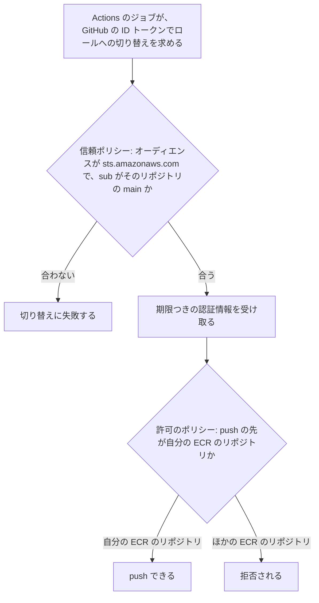

# push 用の IAM ロール

IAM は AWS の利用者と権限を管理するサービスで、IAM ロールは AWS を操作する権限をまとめたものである。push 用の IAM ロールは、領域（独立したリポジトリで作るアプリの単位。[用語](../../architecture/README.md#用語)）の 1 つのリポジトリの GitHub Actions（以下 Actions）が、自分のイメージだけを ECR（AWS のコンテナイメージの置き場）へ push できるようにする。ロールをリポジトリごとに分けるのは、1 つのリポジトリが乗っ取られても、ほかのイメージを書き換えられないようにするためである。この文書は、ロールの名前と push できる先、2 つのポリシー、監査ログ、確認の方法を記す。

このフォルダの全体と、使う語の意味は [インフラの全体像](README.md) にある。

この文書の「権限」は AWS の IAM の権限で、アプリの認可 API とは別物である。

## 流れ

次の図は、Actions のジョブが ECR へ push しようとしたときに、ロールの 2 つのポリシーが何を通し、何を止めるかを示す。ポリシーの中身は「ポリシー」の節にある。

## ロールと push できる先

次の表は、ロールの名前と、push できる ECR のリポジトリを示す。ECR のリポジトリの設定は [ECR のリポジトリ](ecr-repositories.md)にある。ロールは、Terraform（AWS の構成をコードで書いて作る道具）の `infra/shared` で作る（[Terraform の state の置き場所](terraform-state-bucket.md)）。

| ロール | 切り替えを許す GitHub のリポジトリ | push できる ECR のリポジトリ |
|---|---|---|
| `fullstack-lab-ecr-push-web` | `ht-0328/fullstack-lab-web` | `fullstack-lab/nuxt`、`fullstack-lab/bff` |
| `fullstack-lab-ecr-push-api` | `ht-0328/fullstack-lab-api` | `fullstack-lab/api` |
| `fullstack-lab-ecr-push-authz` | `ht-0328/fullstack-lab-authz` | `fullstack-lab/authz` |
| `fullstack-lab-ecr-push-auth` | `ht-0328/fullstack-lab-auth` | `fullstack-lab/auth` |

## ポリシー

次の表は、ロールに付ける 2 つのポリシーを示す。信頼ポリシーは誰がロールに切り替えてよいかを、許可のポリシーはロールで何をしてよいかを決める。トークンの署名は、[GitHub Actions 用の OIDC プロバイダー](github-oidc-provider.md)の登録で確かめる。

| ポリシー | 内容 |
|---|---|
| 信頼ポリシー | トークンのオーディエンスが `sts.amazonaws.com` で、`sub`（どのリポジトリのどのブランチのジョブか）が `repo:ht-0328/fullstack-lab-<名前>:ref:refs/heads/main` のときだけ切り替えを許す |
| 許可のポリシー（すべての ECR に対して） | `ecr:GetAuthorizationToken`（ECR にログインする操作）だけ |
| 許可のポリシー（自分の ECR のリポジトリに対して） | イメージを push する `ecr:BatchCheckLayerAvailability`、`ecr:InitiateLayerUpload`、`ecr:UploadLayerPart`、`ecr:CompleteLayerUpload`、`ecr:PutImage` と、同じタグがあるかを確かめる `ecr:DescribeImages` だけ |

## 監査ログ

CloudTrail（AWS の操作の記録を残すサービス）の既定の記録（90 日分の管理操作のイベント履歴。無料）で、誰がいつロールに切り替え、何を作ったかを追える。追加の設定はしない。

## 確認の方法

次の表は、ロールの絞り方が効いていることの確認の方法を示す。どれも開発者が手で確かめる。

| 対象 | 確かめること |
|---|---|
| 信頼ポリシー | 開発者が main 以外のブランチを選んで [push 用のワークフロー](push-image-workflow.md)を起動すると、ロールへの切り替えで失敗する |
| 許可のポリシー | 開発者が[道具のコンテナ](tools-container.md)で `aws iam simulate-principal-policy`（IAM のポリシーを実際には実行せずに評価するコマンド）を打つ。`api` のロールの `ecr:PutImage` が、`fullstack-lab/bff` には拒否（`implicitDeny`）になる |
