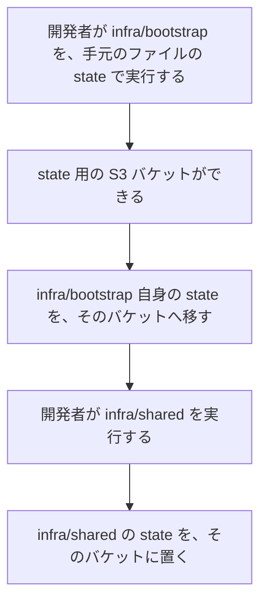

# Terraform の state の置き場所

Terraform は AWS の構成をコードで書いて作る道具で、state は Terraform が作ったリソースを記録したファイルである。state を手元（開発者が作業する PC。[用語](../../architecture/README.md#用語)）のファイルに置くと、PC の故障やファイルの削除で state を失い、作ったリソースを Terraform で管理できなくなる。そのため、state は S3（AWS のファイルの置き場）のバケットに置く。この文書は、そのバケットと、Terraform の 2 つのディレクトリ `infra/bootstrap` と `infra/shared` の state の設定を記す。

このフォルダの全体と、使う語の意味は [インフラの全体像](README.md) にある。

## 流れ

次の図は、state の置き場所ができるまでの順序を示す。`infra/bootstrap` と `infra/shared` は Terraform のディレクトリで、何を作るかは「Terraform のディレクトリ」の節にある。

## Terraform のディレクトリ

Terraform のディレクトリは、state の置き場所を作る `infra/bootstrap` と、アカウントに 1 つあればよいものを作る `infra/shared` の 2 つである。次の表は、ディレクトリごとに作るものを示す。

| ディレクトリ | 作るもの |
|---|---|
| `infra/bootstrap` | state 用の S3 バケット 1 つ |
| `infra/shared` | [ECR のリポジトリ](ecr-repositories.md)、[GitHub Actions 用の OIDC プロバイダー](github-oidc-provider.md)、[push 用の IAM ロール](ecr-push-role.md) |

`infra/shared` が作るものは、どれも環境（dev など）に依存しない。そのため、作っては壊す対象（学習するときだけ作り、終わったら消すもの。[ロードマップの「費用を抑える運用」](../../roadmap/README.md#費用を抑える運用)）にしない。

## state 用の S3 バケット

次の表は、バケットの設定を示す。

| 項目 | 内容 |
|---|---|
| バケット名 | すべての AWS アカウントで一意にするために、アカウント ID を含める。名前は git に入れない `backend.hcl` にだけ書く（「バケット名の扱い」の節） |
| バージョニング | 有効にする。state を誤って上書きしても、前のバージョンに戻せる |
| 暗号化 | SSE-S3（S3 が管理する鍵でファイルを暗号化する設定） |
| 公開の設定 | パブリックアクセスをすべてブロックする。state にはリソースの ID と ARN（AWS のリソースを一意に指す名前）が入るためである |

開発者は、`infra/bootstrap` を 1 回だけ実行する。最初だけ手元のファイルの state を使うのは、state を置くバケットがまだ無いためである。

state の過去のバージョンはバージョニングで残り、バケットを消すときに消える。バケットに個人情報は置かない。

## `infra/shared` の設定

次の表は、`infra/shared` の Terraform の設定を示す。

| 項目 | 内容 |
|---|---|
| state | `infra/bootstrap` が作った S3 バケットに置く |
| ロック | S3 のロックファイル（`use_lockfile`）で取る。ロックは、2 つの Terraform が同時に state を書き換えないようにする仕組みである |
| AWS プロバイダー | AWS プロバイダー（Terraform が AWS を操作するための部品）は 6.23.0 以上を指定する（下限の出所は「`aws login` の認証情報を読めるバージョン」の節） |

## バケット名の扱い

state のバケット名はアカウント ID を含むので、公開のリポジトリに入れない。開発者は、バケット名を `infra/bootstrap/backend.hcl` と `infra/shared/backend.hcl` に書き、リポジトリには見本の `backend.hcl.example` だけを置く。`backend.hcl`、state（`*.tfstate`）、`.terraform/` は、`infra/.gitignore` で git から除く。

## `aws login` の認証情報を読めるバージョン

Terraform の AWS プロバイダーは 6.23.0 から、Terraform 本体の S3 backend（state を S3 に置く設定）は 1.15.0 から、`aws login` の認証情報を読める。出所は、公開の検証記事「[Terraform S3 Backend で aws login 認証が使えるか検証してみた](https://dev.classmethod.jp/articles/terraform-s3-backend-aws-login/)」（Classmethod）で、AWS と HashiCorp の公式の文書には記載が無い。読めなかったときの回避策は、[AWS へのログインの「失敗時の動作」](aws-login.md#失敗時の動作)にある。

## 失敗時の動作

次の表は、state の操作で止まる条件と、開発者がすることを示す。アプリの利用者には影響しない。

| 失敗の条件 | 検知の方法 | 動作 | 開発者がすること |
|---|---|---|---|
| state のロックが残っている | `terraform plan` がロックの取得で止まる | 何も作らない | 他に実行中の Terraform が無いことを確かめてから、`terraform force-unlock` で外す |

## 確認の方法

開発者は、`infra/bootstrap` と `infra/shared` のそれぞれで、`apply` のあとに `plan` を実行し、差分が無いことを確かめる。形式と構文は、[infra リポジトリの CI](infra-ci.md) が AWS に接続せずに確かめる。
