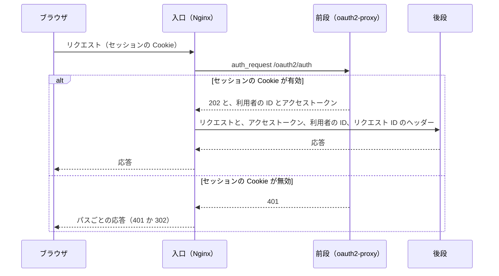
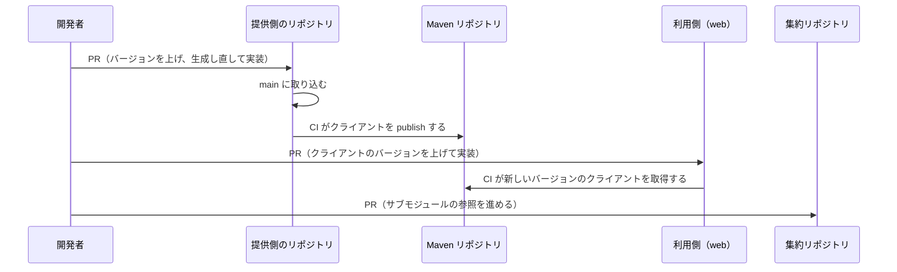

# 領域をまたぐ仕組みの全体像

この文書は、1 つの領域（独立したリポジトリで作るアプリの単位。[用語](../../architecture/README.md#用語)）に収まらない仕組みの全体像を記す。仕組みは、ローカル環境の入口と認証、契約まわり、全体を確かめる仕組みの 3 つに分かれる。細かい決まりはこの文書に書かず、「文書の一覧」の節の表にある個別の文書に書く。

ローカル環境は Docker Compose で動き、定義は集約リポジトリ（領域のリポジトリを git submodule で束ねるリポジトリ fullstack-lab。[用語](../../architecture/README.md#用語)）にある。入口（すべてのリクエストを最初に受けて振り分けるもの。ローカルは Nginx。[用語](../../architecture/README.md#用語)）が、前段（アプリより手前で認証とセッションを担う層。ローカルは oauth2-proxy。[用語](../../architecture/README.md#用語)）に認証を確かめさせてから、画面と BFF（画面専用のサーバー側 API。[用語](../../architecture/README.md#用語)）へ転送する。IdP（ログインを受け付けてトークンを発行するサービス。[用語](../../architecture/README.md#用語)）は Keycloak で、一般利用者用の realm `customer` と社員用の realm `staff` の 2 つを持つ。コンテナ同士のつながりは [architecture の「ローカル環境の構成図」](../../architecture/README.md#ローカル環境の構成図) にある。

領域同士は、契約（領域同士の API の取り決め。各領域の `openapi/*.yaml`。[用語](../../architecture/README.md#用語)）と、契約から生成して publish（Maven リポジトリに登録すること。[用語](../../architecture/README.md#用語)）したクライアントだけでつながる。集約リポジトリのスクリプトと CI が、全体を起動して確かめる。

## このフォルダで使う語

次の表は、このフォルダの文書で使う語のうち、architecture の「用語」の表に無い製品名と仕組みの意味を示す。「用語」の表にある語（入口、前段、IdP、JWT、BFF、契約、提供側と利用側、publish、領域、集約リポジトリ、ホストなど）の意味は、[用語](../../architecture/README.md#用語) にある。個別の文書は、この 2 つの表の語に一言をそえずに使う。

| 語 | 意味 |
|---|---|
| Docker Compose（Compose） | 複数のコンテナを 1 つの定義ファイルからまとめて起動する道具 |
| Nginx | リクエストを受けて後ろのサービスへ転送するプロキシ。ローカル環境の入口に使う |
| ALB、ALB の認証アクション | ALB は AWS のロードバランサー。認証アクションは、ALB が転送の前に IdP でログインさせる機能 |
| oauth2-proxy | OpenID Connect のログインを代行するプロキシ。ローカル環境の前段に使う |
| OpenID Connect | IdP がトークンで利用者の情報を渡す仕組み（「用語」の表の OIDC） |
| Keycloak | IdP として動かす製品 |
| Admin API | Keycloak のユーザーと設定を HTTP で操作する、Keycloak の管理用の API |
| realm | Keycloak の中で、Keycloak のユーザーとクライアントをまとめる区画 |
| Okta | 社員のログインに使う IdP の製品。ローカルでは動かせないので、Keycloak の realm `staff` で代える |
| PKCE | 認可コードを横取りされても使えなくする仕組み |
| クレーム | JWT に含まれる項目 |
| Nuxt | 画面を作るフレームワーク。サーバー側で HTML を作る描画（SSR）も行う |
| Swagger UI | 契約をブラウザで読み、試せる画面 |
| Maven リポジトリ | Java と Kotlin のライブラリを配布する形式の成果物リポジトリ |
| Reposilite | Compose の中で動く Maven リポジトリ |
| GitHub Packages | GitHub の成果物リポジトリ |
| CodeArtifact | AWS の成果物リポジトリのサービス |
| Gradle | Java と Kotlin のビルドツール |
| OpenAPI Generator | 契約から Kotlin のインターフェース、DTO、クライアントを生成する道具 |
| `openapi-typescript` | 契約から TypeScript の型を生成する道具 |
| Jackson | Kotlin と Java で JSON を読み書きするライブラリ |
| PostgreSQL | API がタスクを保存するデータベース |
| WireMock | HTTP の応答を定義して返すスタブサーバー。外部サービスの代わりに使う |
| Karate | API を HTTP で呼んで確かめるテスト |
| Playwright | ブラウザを操作して画面を確かめるテスト |

## 処理の流れ

この節の図は、領域をまたぐ主な流れごとに、誰が誰をどの順に呼ぶかを示す。

### ログインしてから画面が出るまで

未ログインのブラウザが `/` を開いてから HTML を受け取るまでの流れは、[architecture の「ログインの流れ」](../../architecture/README.md#ログインの流れ) の図にある。ブラウザ、入口、前段、IdP、Nuxt、BFF の順のやり取りを 1 枚で示している。前段の分担の細部は [前段（oauth2-proxy）](oauth2-proxy.md) にある。

### 認証済みのリクエストが後段に届くまで

次の図は、認証が要るパスへのリクエストを、入口が前段に確かめてから後段へ転送するまでの流れを示す。後段は、Nuxt、BFF、Swagger UI のどれかである。

渡すヘッダーの細部は [入口（Nginx）の認証の確認と転送するヘッダー](nginx-auth-headers.md) に、パスごとの応答は [入口（Nginx）のホストとパスの振り分け](nginx-routing.md) にある。

### 契約を変えてから利用側が取り込むまで

次の図は、開発者が契約を変えてから、利用側と集約リポジトリが取り込むまでの流れを示す。提供側は契約を定義して公開する側、利用側はそれを呼ぶ側である（[用語](../../architecture/README.md#用語)）。

バージョンの決まりと各段の細部は [契約のバージョンと変更の順序](contract-versioning.md) に、publish と取得の仕組みは [生成クライアントの publish と取得](client-distribution.md) にある。

## 文書の一覧

次の表は、ローカル環境の入口と認証の文書と、それぞれの内容を示す。

| 文書 | 内容 |
|---|---|
| [入口（Nginx）のホストとパスの振り分け](nginx-routing.md) | ホストとパスごとの転送先 |
| [入口（Nginx）の認証の確認と転送するヘッダー](nginx-auth-headers.md) | 入口での認証の確認と、後段へ渡すヘッダー |
| [前段（oauth2-proxy）](oauth2-proxy.md) | ログイン、セッションの Cookie、トークンの更新、ログアウトの分担 |
| [Keycloak のコンテナ](keycloak-container.md) | Keycloak の起動の設定と、呼び出しに使う URL |
| [Keycloak の realm `staff` の定義](keycloak-realm-staff.md) | 社員用の realm の定義 |
| [Docker Compose のサービス](compose-services.md) | Compose のサービスと、起動の順序 |

次の表は、契約まわりの文書と、それぞれの内容を示す。

| 文書 | 内容 |
|---|---|
| [契約からのコード生成](code-generation.md) | 契約から生成するものと、その置き場所 |
| [生成コードの検査（`check-generated`）](check-generated.md) | 生成し忘れと手直しを見つける検査 |
| [生成クライアントの publish と取得](client-distribution.md) | クライアントの publish 先と、BFF からの取得 |
| [契約のバージョンと変更の順序](contract-versioning.md) | 契約の変更で上げるバージョンと、その順序 |
| [Swagger UI](swagger-ui.md) | 契約をブラウザで表示する方法 |

次の表は、全体を確かめる仕組みの文書と、それぞれの内容を示す。

| 文書 | 内容 |
|---|---|
| [スモークテスト（`scripts/smoke-test.sh`）](smoke-test.md) | スモークテストの検査の内容 |
| [テストを実行するスクリプト](test-scripts.md) | 単体テスト、Karate（API のテスト）、Playwright（画面のテスト）を実行するスクリプト |
| [集約リポジトリの CI](ci.md) | 集約リポジトリの CI の実行の内容 |

## 関連

次の文書は、このフォルダの文書と合わせて開くものである。

- 構成図、ログインの流れの図、リポジトリの分け方、用語: [architecture](../../architecture/README.md)
- ほかのフォルダの全体像: [BFF と画面](../web/README.md)、[API](../api/README.md)、[認可 API](../authz/README.md)、[認証 API](../auth/README.md)、[インフラ](../infra/README.md)
- 方針と理由: [ADR-0001](../../adr/ADR-0001-nuxt-generates-types-only.md)、[ADR-0002](../../adr/ADR-0002-distribute-clients-as-artifacts.md)、[ADR-0003](../../adr/ADR-0003-commit-generated-code.md)
