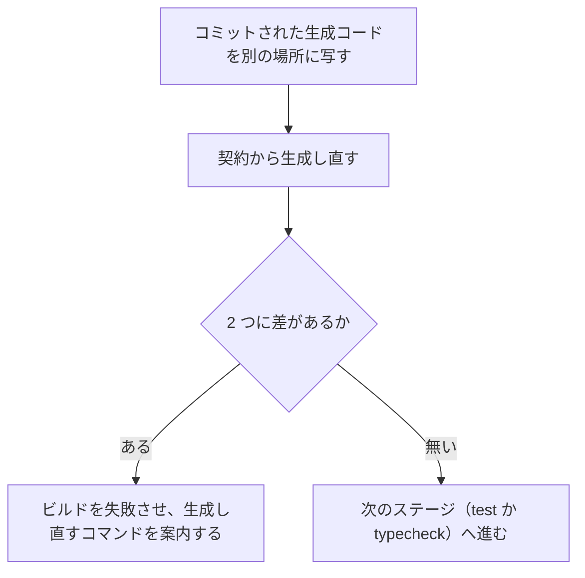

# 生成コードの検査（`check-generated`）

この文書は、契約（領域同士の API の取り決め。各領域の `openapi/*.yaml`。[用語](../../architecture/README.md#用語)）と、git で管理している生成コードが一致していることを確かめる仕組みを記す。確かめるのは、各リポジトリの Dockerfile の `check-generated` ステージである。このステージは、契約だけ直して生成し忘れた変更と、生成コードを手で直した変更を落とす。生成するものと置き場所は [契約からのコード生成](code-generation.md) に、生成コードを git で管理する方針と理由は [ADR-0003](../../adr/ADR-0003-commit-generated-code.md) にある。

このフォルダの全体と、文書で使う語の意味は [領域をまたぐ仕組みの全体像](README.md) にある。

## 動き

`check-generated` ステージは、コミットされた生成コードと、契約から生成し直したコードに差があれば、ビルドを失敗させる。次の図は、その動きを示す。

次の表は、Dockerfile ごとに、比べる対象と、このステージの次に動くステージを示す。

| Dockerfile | 比べる対象 | 次に動くステージ |
|---|---|---|
| `api/Dockerfile`、`authz/Dockerfile`、`auth/Dockerfile` | `src/generated` と `client/src/generated` | `test`（単体テスト） |
| `web/bff/Dockerfile` | `src/generated` | `test`（単体テスト） |
| `web/frontend/Dockerfile` | `app/types/bff.d.ts` | `typecheck`（型チェック） |

`test` と `typecheck` のステージは `check-generated` を土台にするので、単体テストと型チェックを実行すると、先にこの検査が動く。アプリを動かすイメージ（`runtime` ステージ）のビルドは、生成し直さず、コミットされた生成コードをそのまま使う。

## 実行される場面

次の一覧は、この検査が実行される場面を示す。

- 開発者が、集約リポジトリで `./scripts/unit-test.sh` を実行したとき（[テストを実行するスクリプト](test-scripts.md)）
- 領域の各リポジトリの CI が、単体テストと型チェックを実行するとき
