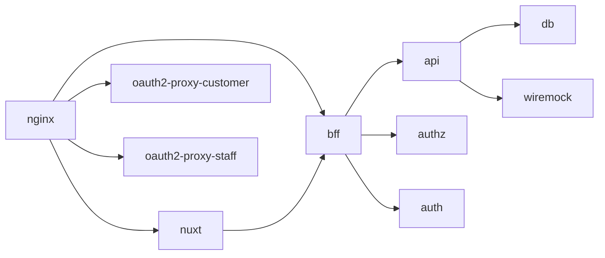

# Docker Compose のサービス

この文書は、集約リポジトリの `compose.yaml` が起動するローカル環境のサービスと、起動の順序を記す。開発者は、集約リポジトリで `docker compose up -d --build --wait` を打つと、全体を起動できる。サービスごとの役割は [architecture/ の「各サービスの役割」](../../architecture/README.md#各サービスの役割) にある。

このフォルダの全体と、文書で使う語の意味は [領域をまたぐ仕組みの全体像](README.md) にある。

## サービスの一覧

次の表は、サービスごとに、イメージの出所と、ホストに公開するポートを示す。ポートの無いサービスには、ホストから直接は届かない。

| サービス | イメージの出所 | ホストに公開するポート |
|---|---|---|
| `nginx` | 公式のイメージ。設定は `nginx/` を読み取り専用で渡す | 8080（`NGINX_HOST_PORT`） |
| `oauth2-proxy-customer`、`oauth2-proxy-staff` | 公式のイメージ | 無い |
| `keycloak` | 公式のイメージ。realm の定義を読み取り専用で渡す | 8180（`KEYCLOAK_HOST_PORT`） |
| `nuxt` | `web/frontend/Dockerfile` からビルドする | 無い |
| `bff` | `web/bff/Dockerfile` からビルドする | 無い |
| `api`、`authz`、`auth` | 各リポジトリの `Dockerfile` からビルドする | 無い |
| `db` | 公式の PostgreSQL のイメージ。データはボリューム `db-data` に置く | 無い |
| `wiremock` | 公式のイメージ。応答の定義は `api/wiremock/` を読み取り専用で渡す | 無い |
| `reposilite` | 公式のイメージ。データはボリューム `reposilite-data` に置く | 8081（`REPOSILITE_HOST_PORT`） |
| `swagger-ui` | 公式のイメージ。各領域の契約を読み取り専用で渡す | 無い |

`bff` のビルドは、生成クライアントを Maven リポジトリから取得する。そのため、Reposilite に届くようにホストのネットワークでビルドし、資格情報は build secret（ビルドの間だけ渡し、イメージに残さない値）で渡す（[生成クライアントの publish と取得](client-distribution.md)）。

## 起動の順序

Compose は、依存先のヘルスチェックが通るまで、依存する側の起動を待たせる。起動した時点ではなく、応答できる時点まで待つので、開発者は起動の順序を手で揃えなくてよい。次の図は、依存の関係を示す。矢印は、起動を待つ相手を指す。

`api` は、`wiremock` についてはヘルスチェックではなく、起動だけを待つ。`bff` と `auth` は、`keycloak` を待たない。BFF は公開鍵を、認証 API は Admin API 用のトークンを、最初のリクエストのときに取得するためである。

## 再起動

次の表は、サービスが止まったときの再起動の設定を示す。

| 設定 | サービス | 動き |
|---|---|---|
| `on-failure` | `nuxt`、`bff`、`api`、`authz`、`auth` | 異常終了したときだけ再起動する。依存先が後から落ちて復帰したときも、自分で立ち直る |
| `unless-stopped` | そのほかのサービス | 開発者が止めない限り再起動する |

## 環境変数と秘密の値

秘密の値と、環境ごとに変わるポートは、集約リポジトリの `.env` に置く。リポジトリには、ダミーの値を入れた `.env.example` だけを置く。必須の値が `.env` に無いと、Compose は起動の前にエラーで止まる。

## 確認の方法

[集約リポジトリの CI](ci.md) は、`docker compose up -d --build --wait` で全サービスのヘルスチェックが通ることを確かめる。
