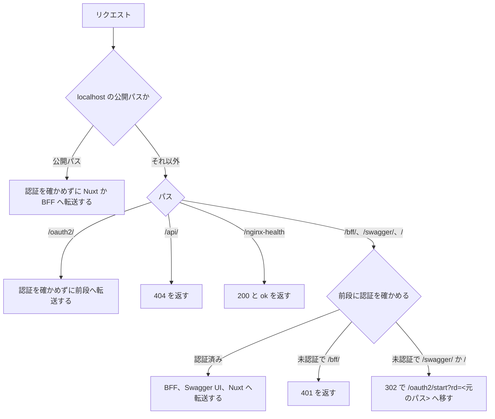

# 入口（Nginx）のホストとパスの振り分け

この文書は、ローカル環境の入口（すべてのリクエストを最初に受けて振り分けるもの。[用語](../../architecture/README.md#用語)）である Nginx が、ホストとパスでリクエストをどこへ転送するかを記す。Nginx は、AWS では ALB（AWS のロードバランサー）が担う役割を、ローカルで代わりに担う。設定は、集約リポジトリの `nginx/conf.d/default.conf` と `nginx/snippets/` にある。

このフォルダの全体と、文書で使う語の意味は [領域をまたぐ仕組みの全体像](README.md) にある。

## 流れ

次の図は、Nginx が 1 つのリクエストの行き先を決める順序を示す。パスごとの転送先と応答の細部は「パス」と「公開パス」の節にある。

## ホスト

次の表は、ホストごとの利用者と、認証を確かめる相手を示す。ホストごとに前段を分けるのは、学習用の仮定である（[仮定 2](../../architecture/README.md#仮定)）。公開パスは、認証なしで転送するパスである（「公開パス」の節）。前段は、アプリより手前で認証とセッションを担う層である（[用語](../../architecture/README.md#用語)）。

| ホスト | 利用者 | 前段 | 公開パス |
|---|---|---|---|
| `localhost` | 一般利用者（マイページ） | `oauth2-proxy-customer` | ある |
| `admin.localhost` | 社員（管理画面） | `oauth2-proxy-staff` | 無い |

どちらのホストも、同じ Nuxt（画面のフレームワーク）と BFF（画面専用のサーバー側 API。[用語](../../architecture/README.md#用語)）へ転送する。利用者の種別は、ホストではなく、BFF が JWT の発行元 `iss` から決める（[JWT の検証](../web/jwt-verification.md)）。Nginx は、ホスト側のポート 8080（環境変数 `NGINX_HOST_PORT` で変えられる）で待ち受ける。

## パス

次の表は、どちらのホストにもあるパスと、転送先、認証の確認と未認証の応答を示す。設定は `nginx/snippets/app-locations.conf` にある。

| パス | 転送先 | 認証の確認と未認証の応答 |
|---|---|---|
| `/oauth2/` | 前段 | 認証を確かめない。ログインの開始、IdP からの戻り、ログアウトに使う |
| `/bff/` | BFF | 401 を `application/problem+json` で返す。`detail` は `login required` |
| `/swagger/` | Swagger UI | 302 で `/oauth2/start?rd=<元のパス>` へ移す |
| `/api/` | 転送しない | 認証に関係なく 404 を返す |
| `/` | Nuxt | 302 で `/oauth2/start?rd=<元のパス>` へ移す |
| `/nginx-health` | 転送しない | 認証を確かめずに 200 と `ok` を返す |

`/bff/` だけが 302 ではなく 401 を返すのは、ブラウザの fetch がログイン画面の HTML を受け取らないようにするためである。画面は、401 を受けたら `/oauth2/start` へ移動する。認可 API と認証 API へ転送するパスは無いので、ブラウザからこの 2 つへは届かない。

## 公開パス

次の表は、認証なしで転送するパスを示す。会員登録を公開パスにするのは、学習用の仮定である（[仮定 13](../../architecture/README.md#仮定)）。公開パスは一般利用者のホスト `localhost` にだけあり、設定は `nginx/snippets/public-locations.conf` にある。

| パス | 転送先 | 用途 |
|---|---|---|
| `/signup` | Nuxt | 会員登録の画面 |
| `/bff/signup` | BFF | 会員登録の API（[会員登録](../web/signup.md)） |
| `/_nuxt/` | Nuxt | 画面の静的アセット。公開の画面の描画に要る |

社員のホスト `admin.localhost` では、`/signup` もログインへ移す。公開パスで後段へ渡すヘッダーは [入口（Nginx）の認証の確認と転送するヘッダー](nginx-auth-headers.md) にある。

## 転送先の名前の解決

Nginx は、転送先のコンテナの名前を、Docker の内部 DNS でリクエストのたびに解決する。転送先のコンテナを作り直しても、Nginx を再起動しなくてよいようにするためである。

## 確認の方法

振り分けは、[スモークテスト](smoke-test.md) の「入口と未認証アクセス」「会員登録とパスワード変更」のまとまりで確かめる。
