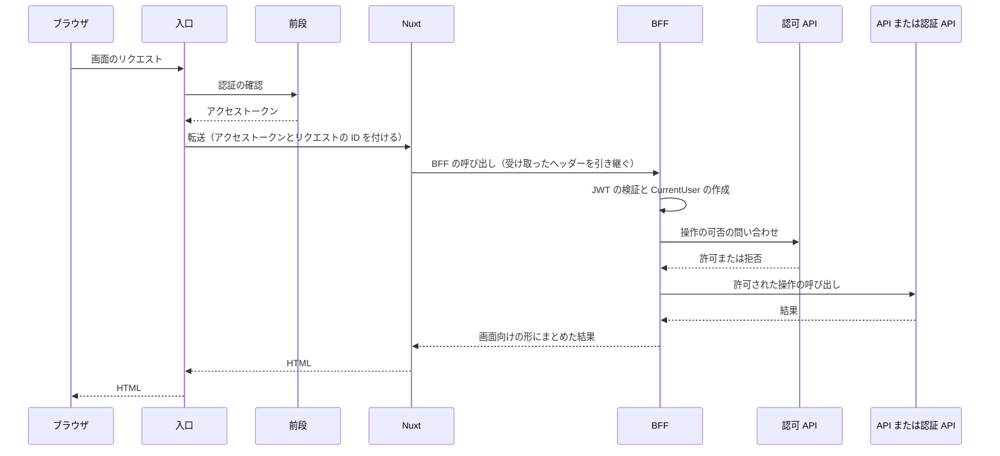
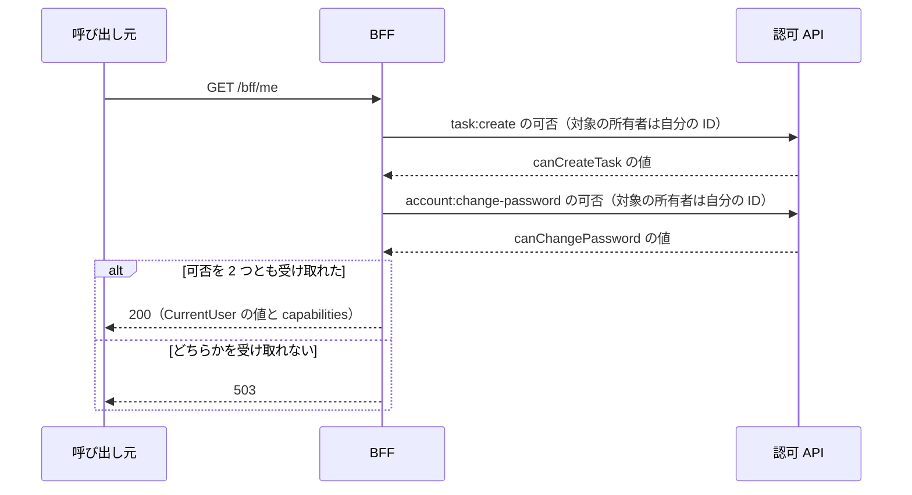
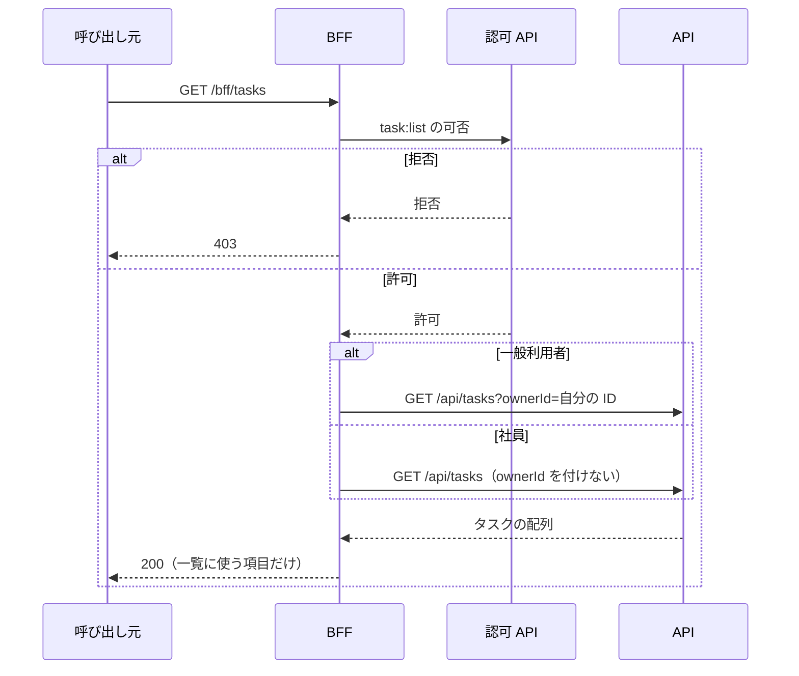
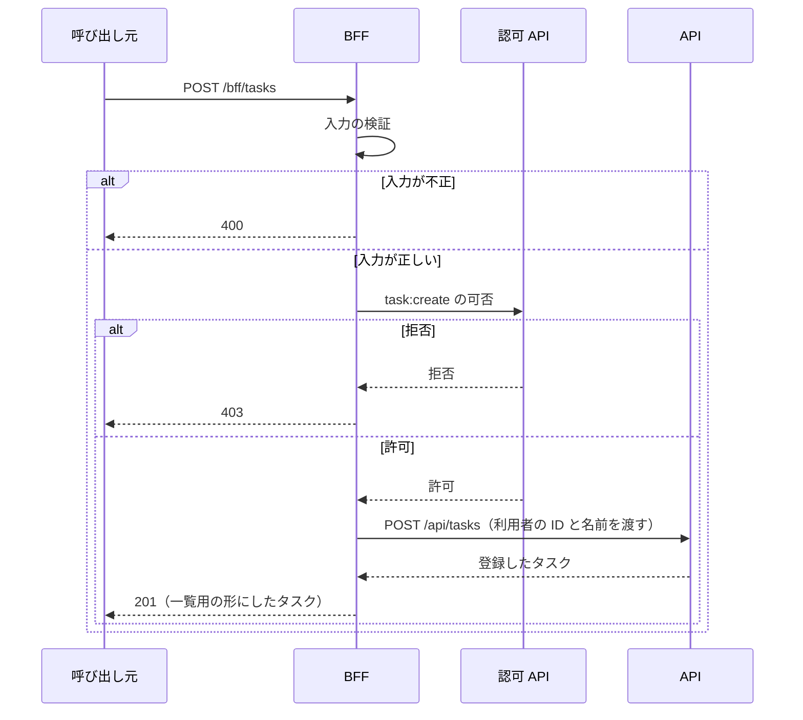
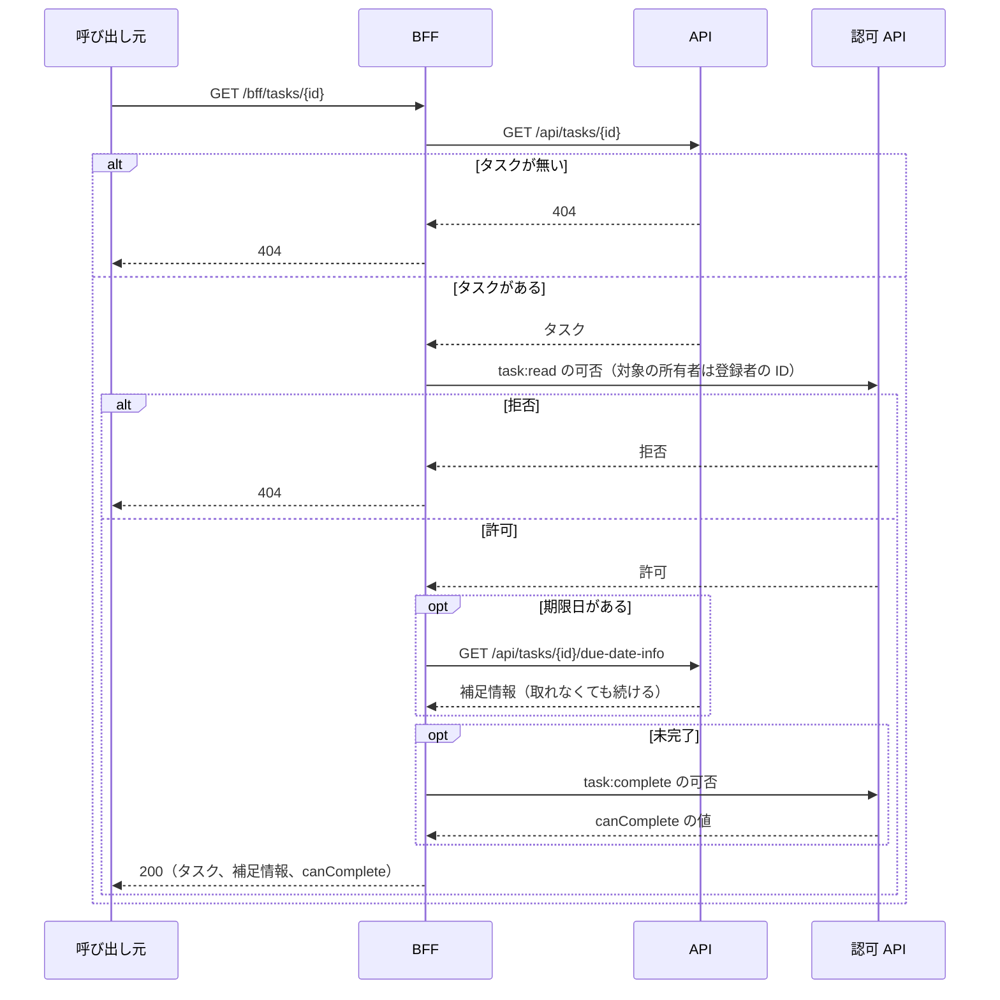
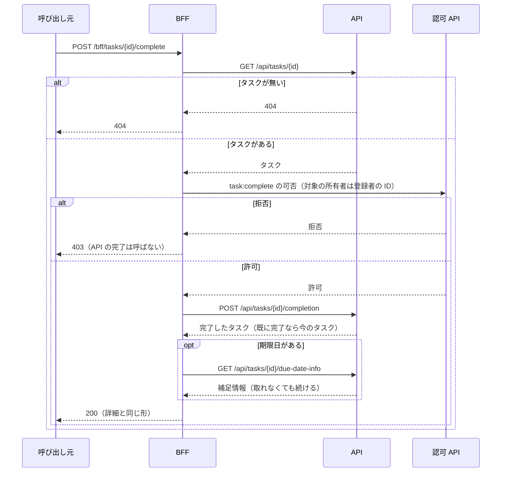
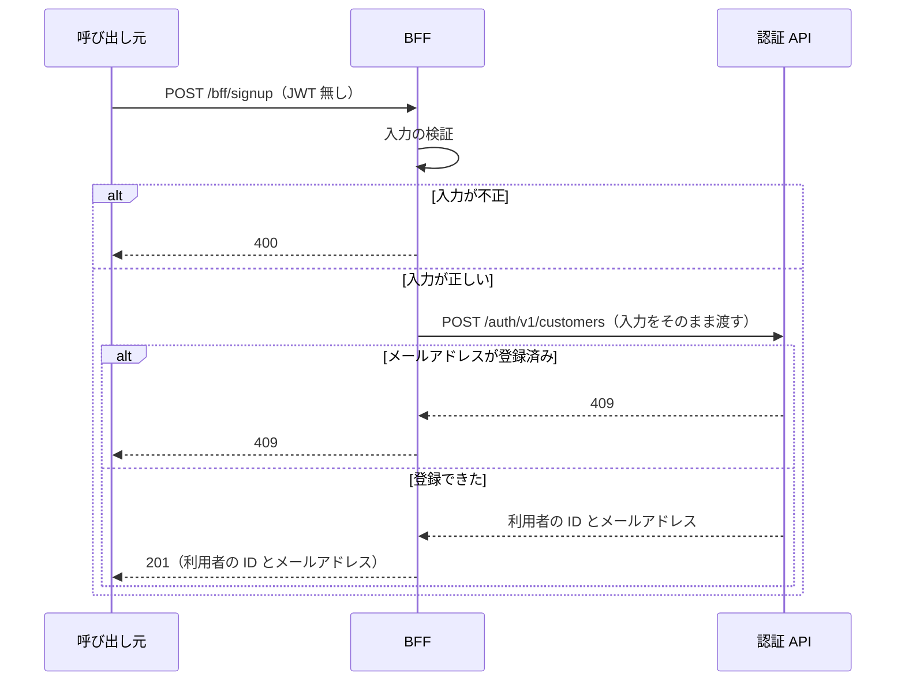
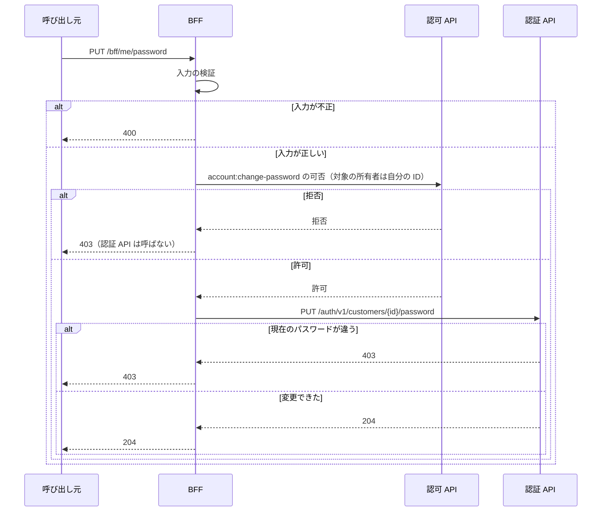

# BFF と画面の全体像

この文書は、`web` リポジトリが作る BFF（`web/bff/`）と画面（`web/frontend/`）の全体像を記す。BFF（Backend for Frontend。[用語](../../architecture/README.md#用語)）は画面専用のサーバー側 API で、Kotlin と Spring Boot（Web アプリを作る Java 系のフレームワーク）で作る。BFF は、JWT（IdP が署名して発行するトークン。[用語](../../architecture/README.md#用語)）を検証し、認可 API に操作の可否を問い合わせ、API と認証 API を呼んで、結果を画面向けの形にまとめる。細かい決まりはこの文書に書かず、「文書の一覧」の節の表にある個別の文書に書く。

リクエストと応答の項目は契約（領域同士の API の取り決め。[用語](../../architecture/README.md#用語)）の [bff.yaml](../../../web/openapi/bff.yaml) にあるので、このフォルダの文書には書き写さない。

## このフォルダで使う語

次の表は、このフォルダの文書で使う語のうち、architecture の「用語」の表に無い製品名、仕組み、このアプリの語の意味を示す。「用語」の表にある語（BFF、JWT、IdP、入口、前段、契約、SSR、縮退、fail-closed など）の意味は、[architecture の「用語」](../../architecture/README.md#用語) にある。個別の文書は、これらの語に一言を繰り返さない。

| 語 | 意味 |
|---|---|
| Spring Boot | Web アプリを作る Java 系のフレームワーク。BFF はこれで作る |
| Spring Security のリソースサーバー | 受け取ったトークンを検証して API を守る側。BFF はこの形で動く |
| Nuxt | 画面を作るフレームワーク。サーバー側で HTML を作る描画（SSR）も行う |
| Keycloak | IdP のソフトウェア。一般利用者のログインに使う |
| realm | Keycloak の中でユーザーと設定を分ける単位 |
| Okta | 社員のログインに使う IdP の製品。ローカルでは、同じ形のクレームを出す Keycloak の realm `staff` で代える |
| クレーム | JWT に含まれる項目 |
| 補足情報 | 期限日が営業日かどうかと祝日の名前。API が、日付が営業日か祝日かを返すカレンダー API（外部サービス）から取る |
| `task-viewer`、`task-admin` | 社員に付ける権限の名前（ロール）。`task-viewer` はタスクの一覧と詳細を見られ、`task-admin` はそれに加えて登録と完了ができる |
| Problem Details | RFC 9457 が決める、エラーの中身を JSON で返す標準の形（`application/problem+json`） |
| DTO | リクエストと応答の項目を持つクラス |
| CSRF トークン | 別サイトからの勝手な送信を防ぐための値 |
| Nginx、oauth2-proxy | ローカル環境の入口と前段に使うプロキシ |
| ALB | AWS のロードバランサー。AWS では入口と前段を担う |
| Playwright | ブラウザを操作して画面を確かめるテスト |
| `MockRestServiceServer` | HTTP の応答を差し替える、Spring のテスト用の部品 |

## 処理の流れ

この節は、BFF がリクエストを処理する順序を、操作ごとのシーケンス図で示す。どの図も、誰が誰をどの順に呼ぶか、呼ぶ先のパス、ステータスコード、主な分岐までを描き、値や理由は個別の文書に書く。BFF は、失敗を決まった形のエラーで返す（[エラー応答](error-responses.md)）。認可 API から可否を受け取れないときの 503 は、「利用者情報の取得」の図にだけ描く。

### 共通の流れ

次の図は、ログイン済みの利用者が画面を開いたときに、リクエストが BFF を通って処理される流れを示す。入口は、すべてのリクエストを最初に受けて振り分けるもので、前段は、アプリより手前で認証とセッションを担う層である（どちらも [用語](../../architecture/README.md#用語)）。Nuxt は、画面を作るフレームワークである。

ブラウザが画面から BFF を呼ぶときは、入口が `/bff/` を BFF へ直接転送し、Nuxt を通らない。`CurrentUser` は、BFF の中で使う利用者情報である。操作ごとの図は、BFF より手前を「呼び出し元」にまとめ、JWT の検証を省いて描く。

- 会員登録だけは、ログインしていない人が呼ぶので、BFF は JWT を要求せず、認可 API への問い合わせも行わない。JWT が付いていれば、会員登録でも先に検証する
- BFF は、認可 API から可否を受け取れなければ、操作を許可しない

呼び出し元とヘッダーは [呼び出し元と受け取るヘッダー](callers-and-headers.md) に、JWT の検証は [JWT の検証](jwt-verification.md) に、認可 API への問い合わせは [認可 API への問い合わせ](authz-decision-call.md) にある。

### 利用者情報の取得

次の図は、BFF が `GET /bff/me` を受けてから、利用者情報を返すまでの流れを示す。

`capabilities` の値は [利用者情報（`GET /bff/me`）](me.md) にある。

### タスクの一覧

次の図は、BFF が `GET /bff/tasks` を受けてから、一覧を返すまでの流れを示す。

一覧に使う項目と、対象の範囲の決まりは [タスクの一覧（`GET /bff/tasks`）](task-list.md) にある。

### タスクの登録

次の図は、BFF が `POST /bff/tasks` を受けてから、登録したタスクを返すまでの流れを示す。

API に渡すヘッダーの中身は [タスクの登録（`POST /bff/tasks`）](task-create.md) にある。

### タスクの詳細

次の図は、BFF が `GET /bff/tasks/{id}` を受けてから、詳細を返すまでの流れを示す。

それぞれの段の理由と、補足情報の縮退、`canComplete` の値は [タスクの詳細（`GET /bff/tasks/{id}`）](task-detail.md) にある。

### タスクの完了

次の図は、BFF が `POST /bff/tasks/{id}/complete` を受けてから、完了後の詳細を返すまでの流れを示す。

それぞれの段の決まりは [タスクの完了（`POST /bff/tasks/{id}/complete`）](task-complete.md) にある。

### 会員登録

次の図は、BFF が `POST /bff/signup` を受けてから、登録の結果を返すまでの流れを示す。

登録のあとの扱いは [会員登録（`POST /bff/signup`）](signup.md) にある。

### パスワード変更

次の図は、BFF が `PUT /bff/me/password` を受けてから、結果を返すまでの流れを示す。

拒否される利用者と、`{id}` に使う値の決まりは [パスワード変更（`PUT /bff/me/password`）](password-change.md) にある。

## 文書の一覧

次の表は、BFF の仕組みの文書と、それぞれの内容を示す。

| 文書 | 内容 |
|---|---|
| [呼び出し元と受け取るヘッダー](callers-and-headers.md) | BFF の呼び出し元と、BFF が受け取るヘッダー |
| [JWT の検証](jwt-verification.md) | JWT の検証の項目、発行元ごとの設定、JWT 無しで呼べるパス |
| [CurrentUser](current-user.md) | JWT から利用者情報を作る方法 |
| [認可 API への問い合わせ](authz-decision-call.md) | 認可 API に渡す値と、可否を受け取れない場合の扱い |
| [API、認可 API、認証 API の呼び出し](upstream-clients.md) | API、認可 API、認証 API を呼ぶクライアントと接続の設定 |
| [エラー応答](error-responses.md) | エラーの形と、ステータスコードごとの条件 |

次の表は、BFF のエンドポイントごとの文書と、それぞれの内容を示す。

| 文書 | 内容 |
|---|---|
| [利用者情報（`GET /bff/me`）](me.md) | ログイン中の利用者の情報と、画面の出し分け用の値を返す処理 |
| [タスクの一覧（`GET /bff/tasks`）](task-list.md) | タスクの一覧を返す処理と、対象の範囲 |
| [タスクの登録（`POST /bff/tasks`）](task-create.md) | タスクを登録する処理と、API に渡す登録者の情報 |
| [タスクの詳細（`GET /bff/tasks/{id}`）](task-detail.md) | タスクの詳細を返す処理、補足情報の縮退、`canComplete` の値 |
| [タスクの完了（`POST /bff/tasks/{id}/complete`）](task-complete.md) | タスクを完了にする処理 |
| [会員登録（`POST /bff/signup`）](signup.md) | 一般利用者のアカウントを登録する処理 |
| [パスワード変更（`PUT /bff/me/password`）](password-change.md) | ログイン中の利用者のパスワードを変える処理 |

次の表は、画面の文書と、それぞれの内容を示す。画面は `web/frontend/` の Nuxt（画面を作るフレームワーク）で作り、データはどれも BFF から取る。画面の見本は [画面の一覧と遷移](screens/index.html) にある。

| 文書 | 内容 |
|---|---|
| [画面から BFF を呼ぶ共通部品（`useBff`、`useMe`）](nuxt-bff-client.md) | 画面から BFF を呼ぶ共通の部品 |
| [共通のヘッダー（`app.vue`）](screen-header.md) | どの画面にも出るヘッダーと、ログインとログアウトのリンク |
| [タスク一覧の画面（`/`）](screen-task-list.md) | タスクの一覧を出す画面 |
| [タスク登録の画面（`/tasks/new`）](screen-task-new.md) | タスクを登録する画面 |
| [タスク詳細の画面（`/tasks/{id}`）](screen-task-detail.md) | タスクの詳細を出し、完了にする画面 |
| [会員登録の画面（`/signup`）](screen-signup.md) | 一般利用者がアカウントを作る画面 |
| [パスワード変更の画面（`/me/password`）](screen-password-change.md) | 一般利用者が自分のパスワードを変える画面 |

## 関連

次の文書は、BFF が呼ぶ相手、BFF より手前の仕組み、構成全体を書いたものである。

- BFF が呼ぶ相手: [API の全体像](../api/README.md)、[認可 API の全体像](../authz/README.md)、[認証 API の全体像](../auth/README.md)
- 入口と前段、契約と生成: [領域をまたぐ仕組みの全体像](../shared/README.md)
- 構成全体と用語: [architecture](../../architecture/README.md)
