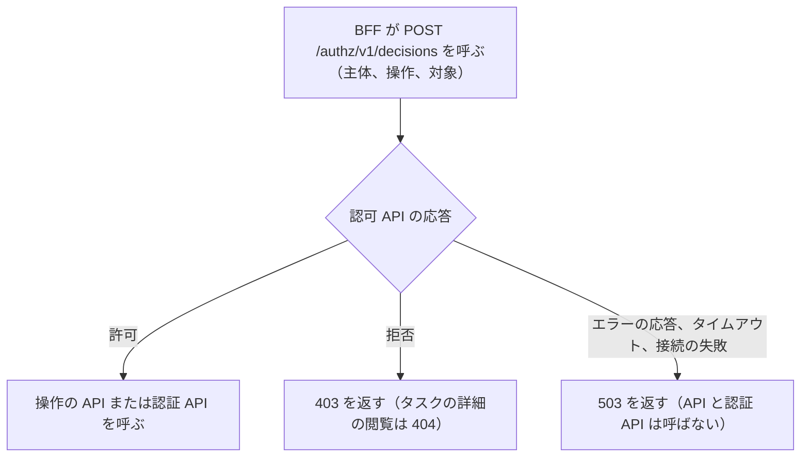

# 認可 API への問い合わせ

この文書は、BFF（画面専用のサーバー側 API。[用語](../../architecture/README.md#用語)）が、操作をしてよいかを認可 API に問い合わせる方法を記す。BFF は、認可 API の `POST /authz/v1/decisions` に、主体、操作、対象を渡して可否を受け取る（[仮定 4](../../architecture/README.md#仮定)）。判定の決まりは認可 API が持ち、BFF は結果に従うだけである。

このフォルダの全体と、使う語の意味は [BFF と画面の全体像](README.md) にある。

## 認可 API の応答による判定

次の図は、BFF が認可 API の応答で処理を分ける判定を示す。誰が誰をどの順に呼ぶかは [全体像の「共通の流れ」](README.md#共通の流れ) の図にある。拒否のときに返すステータスコードは、各エンドポイントの文書にある。

## 渡す値

次の表は、BFF が渡す値を示す。主体の元になる `CurrentUser` は [CurrentUser](current-user.md) にある。

| 渡す値 | 中身 |
|---|---|
| 主体 | `CurrentUser` の `id`、`userType`、`roles` |
| 操作 | エンドポイントごとに決まる操作の名前（「エンドポイントごとの操作」の節） |
| 対象の種類 | タスクの操作は `task`、パスワード変更は `account` |
| 対象の所有者の ID | 操作ごとに違う（「対象の所有者の ID」の節） |

## エンドポイントごとの操作

次の表は、エンドポイントごとに、BFF が認可 API に問い合わせる操作を示す。各エンドポイントの処理は、表のリンク先の文書にある。

| エンドポイント | 問い合わせる操作 |
|---|---|
| [`POST /bff/signup`](signup.md) | なし |
| [`GET /bff/me`](me.md) | `task:create`、`account:change-password` |
| [`PUT /bff/me/password`](password-change.md) | `account:change-password` |
| [`GET /bff/tasks`](task-list.md) | `task:list` |
| [`POST /bff/tasks`](task-create.md) | `task:create` |
| [`GET /bff/tasks/{id}`](task-detail.md) | `task:read`、`task:complete` |
| [`POST /bff/tasks/{id}/complete`](task-complete.md) | `task:complete` |

## 対象の所有者の ID

次の表は、操作ごとに、対象の所有者の ID に何を渡すかを示す。

| 操作 | 対象の所有者の ID |
|---|---|
| `task:list` | 一般利用者は自分の ID。社員は空 |
| `task:create` | 自分の ID |
| `task:read`、`task:complete` | API から取ったタスクの登録者の ID |
| `account:change-password` | 自分の ID |

## 画面の出し分け用の値の問い合わせ

BFF は、画面がボタンや導線を出すかどうかを決めるための値を返す。これらの値は表示を変えるためだけのもので、操作を止める役目は持たない。操作を止めるのは、各エンドポイントが処理の前に行う認可 API への問い合わせである。

BFF は、どの値も、操作のエンドポイントと同じ操作と対象で認可 API に問い合わせて決める。次の表は、値と、その値の決まりを書いた文書を示す。

| 値 | 値の決まりを書いた文書 |
|---|---|
| `capabilities.canCreateTask`、`capabilities.canChangePassword` | [利用者情報（`GET /bff/me`）](me.md) |
| `canComplete` | [タスクの詳細（`GET /bff/tasks/{id}`）](task-detail.md) |

## 可否を受け取れない場合の扱い

BFF は、認可 API から可否を受け取れないとき、操作を許可せず 503 を返す（fail-closed。[用語](../../architecture/README.md#用語)）。503 の `detail` は [エラー応答](error-responses.md) にある。

- 認可 API のエラーの応答（4xx と 5xx）、タイムアウト、接続の失敗を区別せず、どれも 503 にする
- BFF は、503 を返すとき、その操作の API と認証 API を呼ばない
- 画面の出し分け用の値の問い合わせでも同じ扱いにする。`GET /bff/me` と `GET /bff/tasks/{id}` も 503 になる

## テスト

次の表は、認可 API への問い合わせについて確かめることを示す。エンドポイントごとの許可と拒否は、各エンドポイントの文書の「テスト」の節にある。

| 層 | 場所 | 確かめること |
|---|---|---|
| 単体 | `web/bff/src/test/` の `TaskViewServiceTest` | 認可 API がエラーの応答（503）を返したときは、許可せず失敗すること |

## 関連

次の文書は、認可 API の側の決まりを書いたものである。

- 認可 API の全体: [認可 API の全体像](../authz/README.md)
