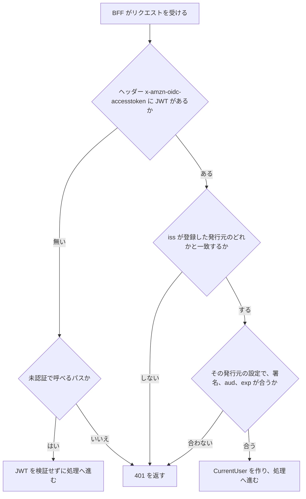

# JWT の検証

この文書は、BFF（画面専用のサーバー側 API。[用語](../../architecture/README.md#用語)）が、受け取った JWT を検証する方法を記す。JWT は、IdP（ログインを受け付けてトークンを発行するサービス）が署名して発行するトークンである（どちらも [用語](../../architecture/README.md#用語)）。BFF は、Spring Security のリソースサーバー（受け取ったトークンを検証して API を守る側）として動く。

このフォルダの全体と、使う語の意味は [BFF と画面の全体像](README.md) にある。

BFF は、ヘッダー `x-amzn-oidc-accesstoken`（[呼び出し元と受け取るヘッダー](callers-and-headers.md)）の値を JWT として取り出し、リクエストごとに検証する。検証する対象を、入口が転送する IdP のアクセストークンにするのは、学習用の仮定である（[仮定 3](../../architecture/README.md#仮定)）。設定は `web/bff/src/main/resources/application.yml` の `app.auth` にあり、実装は `web/bff/src/main/kotlin/com/example/fullstacklab/bff/auth/` にある。

## 流れ

次の図は、BFF がリクエストを受けてから、JWT を検証して処理へ進むか 401 を返すかを決めるまでの流れを示す。確かめることの中身は「確かめること」の節に、JWT が無くても受け付けるパスは「未認証で呼べるパス」の節にある。

## 確かめること

次の表は、BFF が JWT について確かめることを示す。どれか 1 つでも合わなければ、BFF は 401 を返す。

| 確かめること | 内容 |
|---|---|
| 発行元 `iss` | `app.auth.issuers` に登録した発行元の `issuer-uri` のどれかと一致する。BFF は `iss` の値で、その発行元用の検証の設定を選ぶ。登録の無い発行元は拒否する |
| 署名 | 選んだ発行元の `jwk-set-uri` から公開鍵を取得し、署名を検証する |
| 宛先 `aud` | 選んだ発行元の `audience` の値を含む。別のアプリ向けに発行されたトークンを拒否するためである |
| 有効期限 `exp` | 期限が切れていない |

## 発行元ごとの設定

発行元は、一般利用者用の `customer` と、社員用の `staff` の 2 つである。次の表は、発行元ごとの設定を示す。クレームは、JWT に含まれる項目である。`issuer-uri`、`jwk-set-uri`、`audience` の値は環境変数で渡す。

| 項目 | `customer` | `staff` |
|---|---|---|
| IdP | Keycloak（IdP のソフトウェア）の realm（Keycloak の中でユーザーと設定を分ける単位）`customer` | Okta。ローカルでは、Okta と同じ形のクレームを出す Keycloak の realm `staff` |
| 利用者の種別（`user-type`） | `CUSTOMER` | `STAFF` |
| ロールのクレーム（`roles-claim`） | `realm_access.roles` | `groups` |
| 環境変数 | `CUSTOMER_ISSUER_URI`、`CUSTOMER_JWK_SET_URI`、`CUSTOMER_AUDIENCE` | `STAFF_ISSUER_URI`、`STAFF_JWK_SET_URI`、`STAFF_AUDIENCE` |

`issuer-uri` と `jwk-set-uri` を分けているのは、ローカルでは 2 つのホストが違うためである。`issuer-uri` はブラウザから見た IdP の URL で、`jwk-set-uri` は BFF のコンテナから見た IdP の URL である。

表の `user-type` と `roles-claim` の使い方は [CurrentUser](current-user.md) にある。

## 未認証で呼べるパス

次の表は、JWT が無くても BFF が受け付けるパスを示す。これ以外のパスは、どれも検証に通った JWT が要る。表のパスでも、ヘッダーに JWT が付いていれば、BFF は先に検証し、通らなければ 401 を返す。JWT を検証せずに処理へ進むのは、ヘッダーが無いときだけである。

| パス | 用途 |
|---|---|
| `POST /bff/signup` | 会員登録（[会員登録](signup.md)）。入口（すべてのリクエストを最初に受けて振り分けるもの。[用語](../../architecture/README.md#用語)）も、一般利用者のホストでは認証なしで転送する |
| `/actuator/health/**` | コンテナの起動と生存の確認 |
