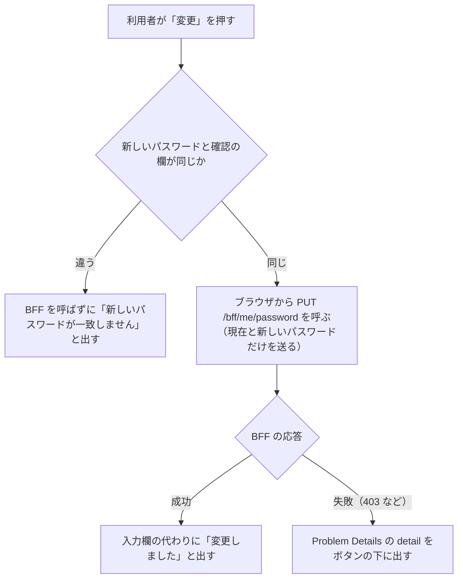

# パスワード変更の画面（`/me/password`）

この文書は、一般利用者が自分のパスワードを変える画面を記す。画面は `web/frontend/app/pages/me/password.vue` にあり、URL は `/me/password` である。この画面への導線は、[共通のヘッダー](screen-header.md) の「パスワード変更」のリンクである。画面の見本は [パスワード変更の見本](screens/password.html) にある。

このフォルダの全体と、使う語の意味は [BFF と画面の全体像](README.md) にある。

## 流れ

次の図は、利用者が「変更」を押してから、画面が結果を出すまでの流れを示す。細かい決まりは「送信」の節にある。

## 入力の項目

次の表は、入力の項目と、画面での制限を示す。入力の決まりそのものは契約（領域同士の API の取り決め。[用語](../../architecture/README.md#用語)）にあり、BFF（画面専用のサーバー側 API。[用語](../../architecture/README.md#用語)）と認証 API も検証する（[パスワード変更（`PUT /bff/me/password`）](password-change.md)）。

| 項目 | 画面での制限 |
|---|---|
| 現在のパスワード | 必須 |
| 新しいパスワード | 必須。8〜128 文字 |
| 新しいパスワード（確認） | 必須。BFF には送らない |

## 送信

次の箇条書きは、図の各段の値と条件を示す。

- 画面は、利用者の ID を送らない。対象の利用者は BFF が決める
- 成功のときの文言は「変更しました。次回から新しいパスワードでログインしてください。」である
- 失敗に当たるのは、認可 API に拒否された 403 と、現在のパスワードが違う 403 である。`detail`（BFF が返す Problem Details の項目。[エラー応答](error-responses.md)）が無ければ、画面は「変更に失敗しました」と出す

この画面は、開くときには変更できるかを確かめない。社員が URL を直接開いて送ると、BFF が 403 を返す。

## テスト

次の表は、この画面について確かめることを示す。Playwright は、ブラウザを操作して画面を確かめるテストである。

| 層 | 場所 | 確かめること |
|---|---|---|
| Playwright | `web/e2e/tests/signup.spec.ts` | 登録した利用者がパスワードを変え、新しいパスワードでログインし直せること |
