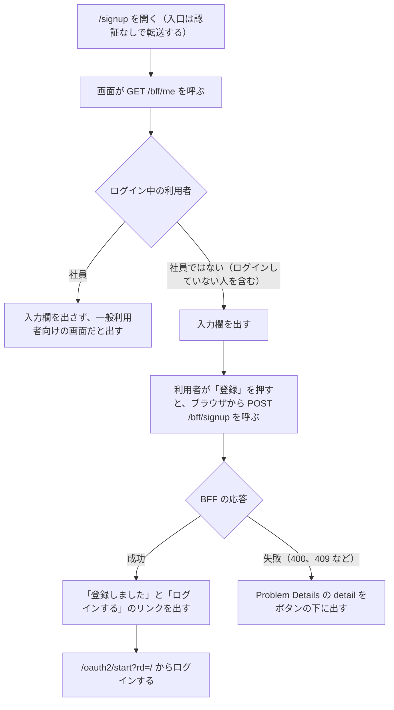

# 会員登録の画面（`/signup`）

この文書は、一般利用者がアカウントを作る画面を記す。画面は `web/frontend/app/pages/signup.vue` にあり、URL は `/signup` である。この画面だけは、ログインしていない人が開ける。画面の見本は [会員登録の見本](screens/signup.html) にある。

このフォルダの全体と、使う語の意味は [BFF と画面の全体像](README.md) にある。

## 流れ

次の図は、ログインしていない人が画面を開いてから、登録を終えるまでの流れを示す。細かい決まりは「ログインしていない状態での描画」「送信」「社員への表示」の節にある。

## ログインしていない状態での描画

入口（すべてのリクエストを最初に受けて振り分けるもの。[用語](../../architecture/README.md#用語)）は、一般利用者のホストの `/signup` を認証なしで転送する。画面が呼ぶ `GET /bff/me` は 401 になるが、`useMe`（[画面から BFF を呼ぶ共通部品](nuxt-bff-client.md)）がこれを「ログインしていない」として扱うので、画面は描画できる。

## 入力の項目

次の表は、入力の項目と、画面での制限を示す。入力の決まりそのものは契約（領域同士の API の取り決め。[用語](../../architecture/README.md#用語)）にあり、BFF（画面専用のサーバー側 API。[用語](../../architecture/README.md#用語)）と認証 API も検証する（[会員登録（`POST /bff/signup`）](signup.md)）。

| 項目 | 画面での制限 |
|---|---|
| メールアドレス（ログイン ID） | 必須。メールアドレスの入力欄。254 文字まで |
| 姓、名 | 必須。それぞれ 50 文字まで |
| パスワード | 必須。8〜128 文字 |

## 送信

画面は、送信している間、ボタンを押せなくする。次の箇条書きは、図の各段の値と条件を示す。

- 成功のときは、入力欄の代わりに文言とリンクを出す。文言は「登録しました（メールアドレス）。登録したメールアドレスとパスワードでログインしてください。」である
- 失敗に当たるのは、入力の不正の 400 と、メールアドレスが登録済みの 409 である。`detail`（BFF が返す Problem Details の項目。[エラー応答](error-responses.md)）が無ければ、画面は「登録に失敗しました」と出す

画面は、登録した人をログイン済みにはしない。入力欄の下には、登録済みの人向けに「ログイン」のリンク（`/oauth2/start?rd=/`）も出す。

## 社員への表示

ログイン中の利用者が社員のとき、画面は入力欄を出さず、「社員のアカウントは IdP 側で管理します。この画面は一般利用者向けです。」と出す。

## テスト

次の表は、この画面について確かめることを示す。Playwright は、ブラウザを操作して画面を確かめるテストである。

| 層 | 場所 | 確かめること |
|---|---|---|
| Playwright | `web/e2e/tests/signup.spec.ts` | 登録した利用者でログインし、タスクを登録できること。登録済みのメールアドレスでは登録できないこと。社員のホストには会員登録の公開パスが無いこと |
