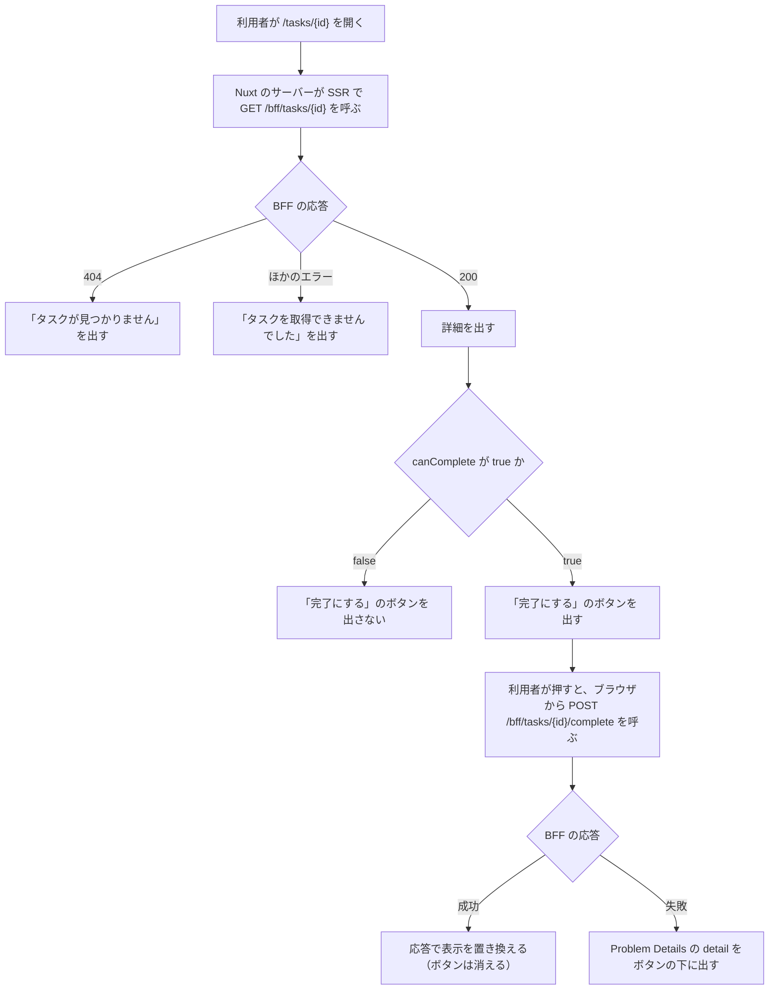

# タスク詳細の画面（`/tasks/{id}`）

この文書は、タスク 1 件の詳細を出し、完了にする画面を記す。画面は `web/frontend/app/pages/tasks/[id].vue` にあり、URL は `/tasks/{id}` である。画面の見本は [タスク詳細の見本](screens/task-detail.html) にある。

このフォルダの全体と、使う語の意味は [BFF と画面の全体像](README.md) にある。

## 流れ

次の図は、画面を開いてから詳細を出すまでと、「完了にする」を押してからの流れを示す。細かい決まりは「データの取得」「表示」「「完了にする」のボタン」の節にある。

## データの取得

画面は、初回の表示のときに SSR（Nuxt のサーバーが HTML を作る描画）で `GET /bff/tasks/{id}` を呼ぶ。応答の中身と、BFF（画面専用のサーバー側 API。[用語](../../architecture/README.md#用語)）が補足情報と `canComplete` を足す決まりは [タスクの詳細（`GET /bff/tasks/{id}`）](task-detail.md) にある。

## 表示

次の表は、画面に出す行と中身を示す。見出しはタスクのタイトルである。

| 行 | 中身 |
|---|---|
| ID、説明、期限日 | 説明と期限日は、無ければ「-」 |
| 期限日の補足（外部サービス） | `dueDateInfoStatus` で変える（文言は、この節の 2 つ目の表） |
| 登録者、登録日時 | 登録者の名前と、登録日時 |
| 状態 | 完了日時があれば「完了（完了日時）」、無ければ「未完了」 |

次の表は、期限日の補足の行に出す文言を示す。

| `dueDateInfoStatus` | 文言 |
|---|---|
| `AVAILABLE` | 営業日なら「営業日」。そうでなければ「休日（祝日の名前）」で、祝日の名前が無ければ「休日（祝日）」 |
| `UNAVAILABLE` | 「現在取得できません」 |
| `NO_DUE_DATE` | 「期限日なし」 |

BFF がエラーを返したとき、画面は表の代わりに文言を出す。404 なら「タスクが見つかりません」、それ以外は「タスクを取得できませんでした（ステータスコード）」である。他人のタスクは BFF が 404 で返すので、「タスクが見つかりません」になる。

## 「完了にする」のボタン

ボタンの有無は表示を変えるだけで、操作を止めるのは BFF である（[タスクの完了（`POST /bff/tasks/{id}/complete`）](task-complete.md)）。次の箇条書きは、図の各段の値と条件を示す。

- 画面は、BFF を呼んでいる間、ボタンを押せなくする
- 成功したときにボタンが消えるのは、応答（完了後の詳細）の `canComplete` が false になるためである
- `detail`（BFF が返す Problem Details の項目。[エラー応答](error-responses.md)）が無ければ、画面は「完了にできませんでした」と出す

## テスト

次の表は、この画面について確かめることを示す。Playwright は、ブラウザを操作して画面を確かめるテストである。

| 層 | 場所 | 確かめること |
|---|---|---|
| Playwright | `web/e2e/tests/tasks.spec.ts` | 補足情報が出ること。外部サービスが落ちていても詳細は出て、補足情報だけが「現在取得できません」になること。他の一般利用者のタスクは、URL を直接開いても見つからないこと |
| Playwright | `web/e2e/tests/tasks.spec.ts` | 本人が完了にでき、完了済みにはボタンが出ないこと。`task-viewer` の社員にはボタンが出ず、直接呼んでも 403 になること。`task-admin` の社員は他人のタスクも完了にできること |
