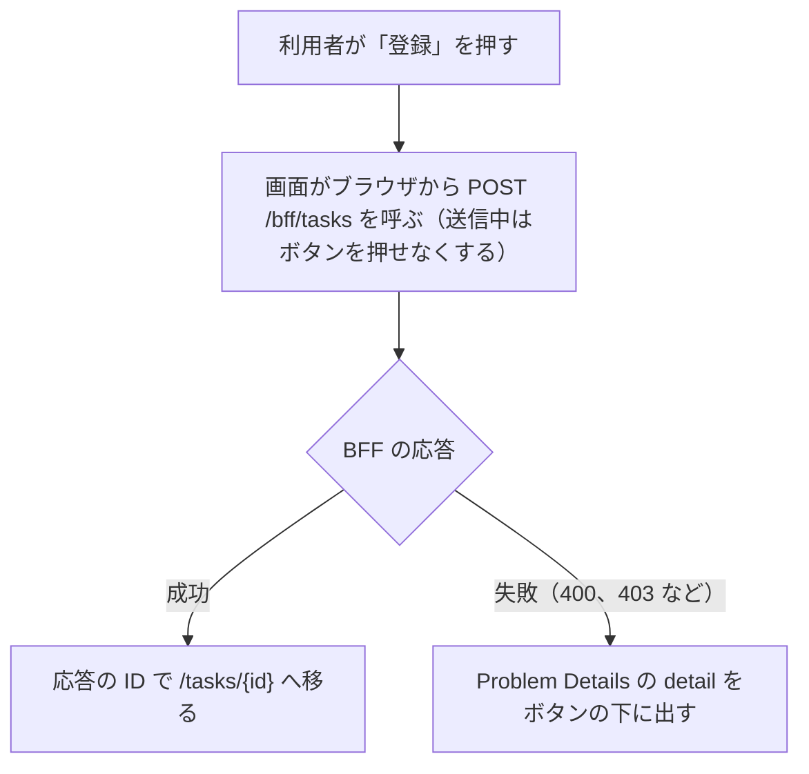

# タスク登録の画面（`/tasks/new`）

この文書は、タスクを登録する画面を記す。画面は `web/frontend/app/pages/tasks/new.vue` にあり、URL は `/tasks/new` である。利用者が入力を送ると、画面は BFF（画面専用のサーバー側 API。[用語](../../architecture/README.md#用語)）に登録を頼み、成功したら詳細の画面へ移る。画面の見本は [タスク登録の見本](screens/task-new.html) にある。

このフォルダの全体と、使う語の意味は [BFF と画面の全体像](README.md) にある。

## 流れ

次の図は、利用者が「登録」を押してから、画面が結果を出すまでの流れを示す。細かい決まりは「送信」の節にある。

## 入力の項目

次の表は、入力の項目と、画面での制限を示す。入力の決まりそのものは契約（領域同士の API の取り決め。[用語](../../architecture/README.md#用語)）にあり、BFF と API も検証する（[タスクの登録（`POST /bff/tasks`）](task-create.md)）。

| 項目 | 画面での制限 |
|---|---|
| タイトル | 必須。100 文字まで |
| 説明 | 任意。1000 文字まで。空なら `null` を送る |
| 期限日 | 任意。日付の入力欄。空なら `null` を送る |

画面は、期限日の欄の下に「2026-11-03 は祝日、2099-12-31 は外部サービス障害のスタブが返ります。」と出す。ローカルで補足情報の表示を試す日付を知らせるためである。

## 送信

次の箇条書きは、図の各段の値と条件を示す。

- 移る先の `{id}` は、BFF の応答にあるタスクの ID である
- 失敗に当たるのは、入力の不正の 400 と、認可 API に拒否された 403 である。`detail`（BFF が返す Problem Details の項目。[エラー応答](error-responses.md)）が無ければ、画面は「登録に失敗しました」と出す

この画面は、開くときには登録できるかを確かめない。登録できない利用者（例: `task-viewer` の社員）が URL を直接開いて送ると、BFF が 403 を返す。

## テスト

次の表は、この画面について確かめることを示す。Playwright は、ブラウザを操作して画面を確かめるテストである。

| 層 | 場所 | 確かめること |
|---|---|---|
| Playwright | `web/e2e/tests/tasks.spec.ts` | 登録すると詳細の画面へ移り、登録したタスクが出ること。`task-admin` の社員が登録できること。`task-viewer` の社員は登録できないこと |
